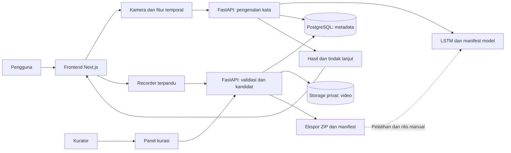

**PENGEMBANGAN MODUL PENGENALAN REAL-TIME 40 KOSAKATA BISINDO BERBASIS MODEL TEMPORAL DENGAN UMPAN BALIK VISUAL DAN PENANGANAN ISYARAT TIDAK TERIDENTIFIKASI PADA SIGNIFY AI**

Proposal Proyek Akhir

Disusun oleh:

**Meiske Priskilla Sahertian**  
**3312401001**

![Logo Politeknik Negeri Batam]()

**PROGRAM STUDI D3 TEKNIK INFORMATIKA**

**JURUSAN TEKNIK INFORMATIKA**  
**POLITEKNIK NEGERI BATAM**  
**2026**

Tahun Akademik 2026–2027

<a id="kata-pengantar"></a>
# KATA PENGANTAR

Puji syukur penulis panjatkan kepada Tuhan Yang Maha Esa atas rahmat dan penyertaan-Nya sehingga proposal Proyek Akhir yang berjudul “Pengembangan Modul Pengenalan Real-Time 40 Kosakata BISINDO Berbasis Model Temporal dengan Umpan Balik Visual dan Penanganan Isyarat Tidak Teridentifikasi pada Signify AI” dapat disusun.

Proposal ini disusun sebagai bagian dari pelaksanaan Proyek Akhir pada Program Studi D3 Teknik Informatika, Jurusan Teknik Informatika, Politeknik Negeri Batam. Pengembangan dilaksanakan dalam tim Signify AI, dengan laporan individu yang menitikberatkan pada pengenalan kata dinamis, layanan inferensi temporal, umpan balik visual, dan mekanisme tindak lanjut terhadap hasil yang belum teridentifikasi. Ruang lingkup dirancang untuk menghasilkan alur perangkat lunak yang terintegrasi dan dapat diuji.

Penulis menyampaikan terima kasih kepada pimpinan dan dosen Program Studi Teknik Informatika, dosen pembimbing Proyek Akhir, keluarga, serta Bunga Citra Lestari Situmorang selaku rekan satu tim atas dukungan dalam proses pendidikan dan penyusunan rencana pengembangan. Penulis mengharapkan masukan untuk menyempurnakan rancangan dan pelaksanaan proyek.

Naskah ini merupakan proposal. Hasil implementasi, pengujian, dan penerimaan pengguna akan dilaporkan setelah kegiatan dilaksanakan. Bab IV menyajikan rencana implementasi dan pengujian modul individu sebagai pelengkap struktur proposal pada template, sehingga tidak memuat hasil empiris yang belum diperoleh.

Batam, 19 September 2026

Meiske Priskilla Sahertian

<a id="daftar-isi"></a>
# DAFTAR ISI

- [KATA PENGANTAR](#kata-pengantar)
- [DAFTAR TABEL](#daftar-tabel)
- [DAFTAR GAMBAR](#daftar-gambar)
- [DAFTAR LAMPIRAN](#daftar-lampiran)
- [ABSTRAK](#abstrak)
- [BAB I PENDAHULUAN](#bab-i-pendahuluan)
  - [1.1. Latar Belakang](#11-latar-belakang)
  - [1.2. Rumusan Masalah](#12-rumusan-masalah)
  - [1.3. Tujuan](#13-tujuan)
  - [1.4. Batasan Masalah](#14-batasan-masalah)
  - [1.5. Manfaat](#15-manfaat)
  - [1.6. Kolaborasi dan Sinergi dalam Pelaksanaan Proyek](#16-kolaborasi-dan-sinergi-dalam-pelaksanaan-proyek)
- [BAB II TINJAUAN PUSTAKA](#bab-ii-tinjauan-pustaka)
  - [2.1. Tinjauan Solusi dan Sistem Terkait](#21-tinjauan-solusi-dan-sistem-terkait)
  - [2.2. Landasan Konsep dan Teknologi](#22-landasan-konsep-dan-teknologi)
  - [2.3. Metode Pengembangan Produk](#23-metode-pengembangan-produk)
- [BAB III ANALISIS DAN PERANCANGAN](#bab-iii-analisis-dan-perancangan)
  - [3.1. Pengumpulan Data](#31-pengumpulan-data)
  - [3.2. Preprocessing Data](#32-preprocessing-data)
  - [3.3. Penerapan Metode AI](#33-penerapan-metode-ai)
  - [3.4. Integrasi ke Aplikasi](#34-integrasi-ke-aplikasi)
  - [3.5. Evaluasi Hasil](#35-evaluasi-hasil)
- [BAB IV RENCANA IMPLEMENTASI DAN PENGUJIAN MODUL PENGENALAN KATA](#bab-iv-rencana-implementasi-dan-pengujian-modul-pengenalan-kata)
  - [4.1. Rencana Implementasi dan Luaran Individu](#41-rencana-implementasi-dan-luaran-individu)
  - [4.2. Rancangan Evaluasi Model](#42-rancangan-evaluasi-model)
  - [4.3. Rancangan Pengujian Fungsional dan Latensi](#43-rancangan-pengujian-fungsional-dan-latensi)
  - [4.4. Rencana Penerimaan Pengguna dan Demonstrasi](#44-rencana-penerimaan-pengguna-dan-demonstrasi)
  - [4.5. Jadwal, Luaran, dan Kriteria Penyelesaian](#45-jadwal-luaran-dan-kriteria-penyelesaian)
- [DAFTAR PUSTAKA](#daftar-pustaka)
- [LAMPIRAN](#lampiran)
  - [Lampiran A. Instrumen Pengumpulan Kebutuhan](#lampiran-a-instrumen-pengumpulan-kebutuhan)
  - [Lampiran B. Identitas Produk dan Sumber Observasi Internal](#lampiran-b-identitas-produk-dan-sumber-observasi-internal)
  - [Lampiran C. Protokol Pengujian dan UAT](#lampiran-c-protokol-pengujian-dan-uat)
  - [Lampiran D. Rencana Dokumentasi Data dan Artefak](#lampiran-d-rencana-dokumentasi-data-dan-artefak)

<a id="daftar-tabel"></a>
# DAFTAR TABEL

- [Tabel 1.1. Pembagian peran dan tanggung jawab tim](#tabel-1-1)
- [Tabel 2.1. Penelitian terkait dan relevansinya terhadap pengembangan sistem](#tabel-2-1)
- [Tabel 3.1. Sumber data dan rencana penggunaannya](#tabel-3-1)
- [Tabel 3.2. Perbandingan kondisi awal dan rancangan pengembangan](#tabel-3-2)
- [Tabel 3.3. Kebutuhan sistem dan penanggung jawab](#tabel-3-3)
- [Tabel 3.4. Use case sistem dan batas kontribusi individu](#tabel-3-4)
- [Tabel 3.5. Rancangan layanan API](#tabel-3-5)
- [Tabel 3.6. Entitas data dan hubungan utama](#tabel-3-6)
- [Tabel 3.7. Kerangka evaluasi sistem bersama](#tabel-3-7)
- [Tabel 4.1. Rencana implementasi modul pengenalan kata](#tabel-4-1)
- [Tabel 4.2. Target awal dan bukti evaluasi pengenalan](#tabel-4-2)
- [Tabel 4.3. Matriks pengujian modul pengenalan kata](#tabel-4-3)
- [Tabel 4.4. Rencana waktu pelaksanaan Meiske](#tabel-4-4)

<a id="daftar-gambar"></a>
# DAFTAR GAMBAR

- [Gambar 3.1. Rancangan arsitektur pengenalan kata dan ekspansi dataset.](#gambar-3-1)
- [Gambar 3.2. Alur integrasi hasil pengenalan dan kontribusi dataset.](#gambar-3-2)

<a id="daftar-lampiran"></a>
# DAFTAR LAMPIRAN

- [Lampiran A. Instrumen Pengumpulan Kebutuhan](#lampiran-a-instrumen-pengumpulan-kebutuhan)
- [Lampiran B. Identitas Produk dan Sumber Observasi Internal](#lampiran-b-identitas-produk-dan-sumber-observasi-internal)
- [Lampiran C. Protokol Pengujian dan UAT](#lampiran-c-protokol-pengujian-dan-uat)
- [Lampiran D. Rencana Dokumentasi Data dan Artefak](#lampiran-d-rencana-dokumentasi-data-dan-artefak)

<a id="abstrak"></a>
# ABSTRAK

Signify AI merupakan aplikasi pengenalan alfabet BISINDO yang akan dikembangkan untuk memproses kosakata dinamis. Sistem awal belum menyediakan pengelolaan sekuens gerakan, hasil kata, serta tindak lanjut yang terintegrasi ketika gerakan belum dapat dikenali. Proyek Akhir ini bertujuan mengembangkan modul pengenalan 40 kosakata BISINDO dari kamera web sampai keluaran antarmuka melalui layanan inferensi temporal. Dataset awal berupa 2.000 video dalam 40 label akan diaudit dan dibagi berdasarkan kelompok sumber untuk mengurangi kebocoran data. Pendekatan yang direncanakan menggunakan landmark tangan dan tubuh bagian atas, normalisasi temporal, serta model Long Short-Term Memory. Pengembangan aplikasi meliputi pengelolaan kamera dan state percobaan, API sekuens, penampil kata dan keyakinan model, riwayat hasil, serta pemicu kontribusi data. Evaluasi akan mencakup akurasi, macro-F1, kesalahan per kelas, penerimaan dan penolakan prediksi, latensi akhir pengambilan gerakan hingga tampilan hasil, serta pengujian fungsional dan penerimaan pengguna. Luaran yang diharapkan adalah modul pengenalan kata yang dapat digunakan secara menyeluruh dan mengarahkan pengguna ke alur kontribusi saat diperlukan. Ruang lingkup dibatasi pada satu kata atau ungkapan per percobaan dan tidak mencakup penerjemahan percakapan bebas maupun pelatihan ulang otomatis.

**Kata Kunci:** BISINDO; pengenalan kata dinamis; LSTM; inferensi real-time; aplikasi web.

<a id="bab-i-pendahuluan"></a>
# BAB I PENDAHULUAN

<a id="11-latar-belakang"></a>
## 1.1. Latar Belakang

Bahasa Isyarat Indonesia (BISINDO) menjadi konteks pengembangan teknologi pengenalan isyarat pada Proyek Akhir ini. Pengenalan kata melalui kamera memerlukan pengolahan perubahan gerakan sepanjang waktu. Penelitian Saputra dan Rakun (2024) menggabungkan deteksi tangan dan wajah, ekstraksi fitur, serta LSTM untuk pengenalan BISINDO pada latar yang kompleks. Penelitian tersebut memperlihatkan relevansi informasi temporal dalam pengembangan sistem pengenalan berbasis video. [Saputra dan Rakun (2024)](https://doi.org/10.11591/ijeecs.v36.i3.pp1583-1593).

Signify AI merupakan aplikasi yang dikembangkan pada proyek sebelumnya oleh tim. Berdasarkan observasi internal terhadap kode sumber dan dokumen teknis pada 19 September 2026, aplikasi menyediakan pengenalan alfabet A–Z melalui kamera, latihan, riwayat, referensi, dan profil. Inferensi alfabet berjalan pada peramban menggunakan YOLO11n berformat ONNX, sedangkan layanan FastAPI masih digunakan untuk pengembangan dan pengujian tertentu. Temuan mengenai kondisi aplikasi ini bersumber dari **observasi internal proyek**, bukan dari artikel ilmiah; identitas berkas yang menjadi bukti dijelaskan pada Lampiran B.

Tim telah memiliki dataset mandiri berisi 40 label kosakata dengan 50 video per label, sehingga inventaris awal mencakup 2.000 video. Sebagian label merupakan ungkapan, seperti “Apa Kabar” dan “Terima Kasih”, yang diperlakukan sebagai satu kelas. Ketersediaan tersebut menjadi dasar pengembangan pengenalan kata dinamis. Akan tetapi, jumlah berkas belum membuktikan keterwakilan pemeraga, independensi sampel, ketepatan label, maupun kualitas setiap rekaman. Pemeriksaan metadata dan penyusunan protokol evaluasi tetap diperlukan. Inventaris tersebut juga merupakan data awal internal proyek, bukan dataset yang diklaim berasal dari publikasi ilmiah.

Pengembangan dirancang dalam dua alur yang saling melengkapi: pengenalan 40 kosakata awal dan pengumpulan data untuk ekspansi. Perhatian terhadap pengumpulan, validasi, serta integrasi data sejalan dengan kajian *data-centric AI* oleh Whang et al. (2023). Dalam proyek ini, prinsip tersebut diterapkan sebagai dasar keputusan rekayasa untuk menghubungkan kegagalan pengenalan dengan kontribusi data yang dapat ditinjau manusia. [Whang et al. (2023)](https://doi.org/10.1007/s00778-022-00775-9).

Pekerjaan pengenalan kata memerlukan perubahan pada representasi masukan dan interaksi pengguna. Mengubah bobot model saja belum menyediakan pengelolaan awal–akhir gerakan, penanganan frame hilang, penyajian hasil sementara, atau pembedaan hasil tidak dikenali dengan gangguan layanan. Pengguna juga membutuhkan pilihan yang jelas ketika hasil model belum sesuai. Oleh karena itu, masalah yang disorot pada laporan ini ialah bagaimana membangun alur pengenalan temporal yang terhubung dari kamera, layanan inferensi, keputusan hasil, sampai umpan balik dan riwayat.

Fokus Meiske mencakup pemanfaatan dataset awal, penerapan model temporal, pengembangan layanan sekuens, serta antarmuka pengenalan. Keberhasilannya akan dinilai melalui kualitas pengenalan seluruh 40 label, ketepatan perilaku aplikasi, dan latensi penggunaan. Integrasi dengan modul Bunga dibatasi pada penyerahan konteks kontribusi yang sah. Label baru yang terkumpul tidak menjadi bagian kemampuan model baseline sebelum proses pelatihan dan evaluasi berikutnya.

Berdasarkan fokus tersebut, proyek diajukan dengan judul “Pengembangan Modul Pengenalan Real-Time 40 Kosakata BISINDO Berbasis Model Temporal dengan Umpan Balik Visual dan Penanganan Isyarat Tidak Teridentifikasi pada Signify AI”.

<a id="12-rumusan-masalah"></a>
## 1.2. Rumusan Masalah

1. Bagaimana merancang dan menerapkan pipeline temporal dari kamera web hingga layanan inferensi untuk pengenalan 40 kosakata BISINDO?
2. Bagaimana mengintegrasikan hasil model, kualitas masukan, confidence, riwayat, dan pemicu kontribusi agar pengguna memperoleh umpan balik yang konsisten?
3. Bagaimana mengevaluasi kualitas pengenalan, latensi E2E, dan keandalan fungsi modul pada protokol data serta lingkungan uji yang terdokumentasi?

<a id="13-tujuan"></a>
## 1.3. Tujuan

1. Mengembangkan pipeline sekuens kamera dan layanan model temporal dengan kontrak fitur serta pemetaan 40 label yang teridentifikasi.
2. Mengembangkan antarmuka pengenalan kata yang menyajikan progres, hasil final, keyakinan model, riwayat, serta pilihan tindak lanjut terhadap input atau hasil yang belum memadai.
3. Menghasilkan laporan pengujian model, latensi, fungsi, dan integrasi berdasarkan test set terpisah serta skenario kamera nyata, sehingga kemampuan dan keterbatasan modul dapat dipertanggungjawabkan.

<a id="14-batasan-masalah"></a>
## 1.4. Batasan Masalah

1. Objek pengenalan dibatasi pada 40 label baseline mandiri, dengan satu kata/ungkapan dan satu pemeraga dalam satu percobaan.
2. Model awal yang direncanakan ialah LSTM berbasis landmark tangan dan tubuh bagian atas; rincian fitur serta parameter ditetapkan melalui uji pendahuluan.
3. Input berasal dari kamera web dengan awal–akhir percobaan eksplisit. Durasi awal 3–5 detik akan diperiksa terhadap karakteristik dataset agar gerakan tidak dipotong secara tidak tepat.
4. Inferensi kata dikembangkan melalui API FastAPI baru. Kemampuan alfabet yang telah ada merupakan fondasi yang digunakan kembali, bukan kontribusi baru yang diklaim.
5. Pembagian data mempertimbangkan pemeraga/sesi. Generalisasi ke pemeraga baru hanya dapat dinyatakan apabila tersedia data uji yang mendukungnya.
6. Pekerjaan penulis mencakup pemicu kontribusi dan kontrak konteks; recorder, kurasi, dan ekspor menjadi tanggung jawab Bunga.
7. Penerjemahan percakapan kontinu, avatar 3D, animasi kompleks, TTS berat, serta auto-retraining dan auto-deployment berada di luar ruang lingkup.
8. Evaluasi dibatasi pada perangkat, browser, dan kondisi jaringan yang dicatat; tidak ada janji akurasi atau latensi yang berlaku untuk seluruh kondisi penggunaan.

<a id="15-manfaat"></a>
## 1.5. Manfaat

Manfaat yang diharapkan dari pengembangan sistem adalah sebagai berikut.

1. **Bagi pengguna**, menyediakan sarana pengenalan kosakata BISINDO terbatas melalui kamera, disertai umpan balik yang menjelaskan hasil, keterbatasan, dan pilihan tindak lanjut.
2. **Bagi kontributor dan pengelola dataset**, menyediakan proses perekaman, peninjauan, dan pengemasan data yang konsisten sehingga status serta asal setiap kandidat dapat ditelusuri.
3. **Bagi pengembang Signify AI**, menyediakan fondasi aplikasi yang menghubungkan inferensi dengan penyiapan data untuk pengembangan model berikutnya secara terkendali.
4. **Bagi bidang rekayasa perangkat lunak terapan**, menyediakan dokumentasi penerapan model temporal dan pengelolaan dataset dalam sistem web yang terintegrasi, beserta protokol pengujian yang dapat dijalankan ulang.

Manfaat tersebut merupakan luaran yang diharapkan. Proposal ini tidak menyatakan bahwa aplikasi menggantikan penerjemah bahasa isyarat atau telah terbukti meningkatkan kualitas komunikasi pengguna.

<a id="16-kolaborasi-dan-sinergi-dalam-pelaksanaan-proyek"></a>
## 1.6. Kolaborasi dan Sinergi dalam Pelaksanaan Proyek

Proyek Akhir dilaksanakan oleh Meiske Priskilla Sahertian dan Bunga Citra Lestari Situmorang dalam satu pengembangan Signify AI. Setiap mahasiswa mengerjakan satu proses bisnis secara menyeluruh, meliputi analisis, antarmuka pengguna, layanan backend, penyimpanan data, pengujian, dan dokumentasi. Pembagian tersebut menghindari pemisahan kontribusi yang hanya menempatkan seorang mahasiswa pada model dan mahasiswa lainnya pada tampilan.

<a id="tabel-1-1"></a>
**Tabel 1.1. Pembagian peran dan tanggung jawab tim**

| Mahasiswa | Modul dan proses bisnis | Tanggung jawab individu | Luaran serah-terima |
|---|---|---|---|
| Meiske Priskilla Sahertian (3312401001), ketua | Pengenalan 40 kosakata dinamis | Penyiapan baseline; ekstraksi fitur dan model temporal; kamera serta umpan balik; API sekuens; keputusan hasil; riwayat pengenalan; pemicu kontribusi; evaluasi model dan latensi | Model beserta manifest; kontrak prediksi; identitas peristiwa pengenalan yang dapat dirujuk kontribusi |
| Bunga Citra Lestari Situmorang (3312401034), anggota | Pengumpulan dan kurasi dataset ekspansi | Recorder terpandu; validasi video; koleksi pengguna; hapus tunggal/massal; penyimpanan privat; panel kurator; keputusan approve/reject; ekspor ZIP; uji integritas dan penerimaan pengguna | Kandidat dengan status terlacak; batch video berlabel dan manifest yang dapat dibaca pipeline pelatihan |
| Kedua mahasiswa | Integrasi sistem | Kesepakatan skema label, autentikasi, kontrak serah-terima, pengujian lintas modul, dan dokumentasi instalasi | Alur hasil belum dikenali → kontribusi → kurasi → ekspor yang dapat didemonstrasikan |

Hubungan kedua modul menggunakan identitas peristiwa pengenalan, alasan kontribusi, dan versi model. Video kontribusi direkam secara khusus setelah persetujuan pengguna. Modul kontribusi juga dapat digunakan melalui menu mandiri sehingga tetap berfungsi ketika model temporal belum siap. Data yang disetujui tidak langsung mengubah kosakata model aktif; pelatihan dan penerapan model berikutnya dilakukan secara manual.

Laporan individu menggunakan landasan pustaka dan rancangan sistem bersama. Perbedaan terletak pada rumusan masalah, tujuan, penekanan tanggung jawab, rencana implementasi, serta bukti pengujian modul masing-masing. Pemanfaatan komponen aplikasi lama akan dicatat sebagai penggunaan kembali, sedangkan kontribusi baru dibuktikan melalui perubahan fungsional dan hasil pengujian.

<a id="bab-ii-tinjauan-pustaka"></a>
# BAB II TINJAUAN PUSTAKA

<a id="21-tinjauan-solusi-dan-sistem-terkait"></a>
## 2.1. Tinjauan Solusi dan Sistem Terkait

Tinjauan pustaka mencakup pengenalan isyarat berbasis video, representasi gerakan, kualitas data, dokumentasi dataset, dan rekayasa sistem pembelajaran mesin. Artikel dipilih berdasarkan kesesuaiannya dengan dua proses bisnis, bukan berdasarkan kesamaan framework aplikasi. Perbedaan bahasa isyarat, dataset, protokol, dan jenis metrik diperhatikan agar hasil penelitian terdahulu tidak dipindahkan langsung menjadi klaim kinerja Signify AI.

<a id="tabel-2-1"></a>
**Tabel 2.1. Penelitian terkait dan relevansinya terhadap pengembangan sistem**

| Penelitian | Fokus dan temuan yang relevan | Pemanfaatan dalam proyek dan batasnya |
|---|---|---|
| [Saputra dan Rakun (2024)](https://doi.org/10.11591/ijeecs.v36.i3.pp1583-1593) | Pengenalan BISINDO dengan detektor, MobileNetV2, dan LSTM pada variasi latar | Acuan pemrosesan temporal; konfigurasi dan hasilnya tidak dianggap berlaku pada dataset lokal. |
| [Li et al. (2020)](https://doi.org/10.1109/WACV45572.2020.9093512) | WLASL menyediakan data video tingkat kata serta membandingkan representasi visual dan pose | Acuan unit video–label; bahasa yang diteliti adalah ASL, sehingga label dan hasil tidak ditransfer langsung ke BISINDO. |
| [Zhang et al. (2020)](https://arxiv.org/abs/2006.10214) | MediaPipe Hands menggabungkan deteksi telapak dan estimasi landmark tangan | Acuan ekstraksi posisi tangan; pelacakan landmark belum merupakan pengenal kosakata. |
| [Bazarevsky et al. (2020)](https://arxiv.org/abs/2006.10204) | BlazePose menghasilkan titik tubuh untuk pelacakan pose pada perangkat | Acuan posisi tubuh bagian atas; performa perangkat penelitian bukan hasil benchmark Signify AI. |
| [Gebru et al. (2021)](https://doi.org/10.1145/3458723) | *Datasheets* mendokumentasikan motivasi, komposisi, pengumpulan, dan penggunaan dataset | Acuan metadata serta dokumentasi ekspor; bukan implementasi recorder dan kurasi proyek ini. |
| [Sambasivan et al. (2021)](https://doi.org/10.1145/3411764.3445518) | Studi praktik AI mengidentifikasi dampak berantai persoalan kualitas data | Acuan penelusuran asal dan keputusan data; konteks penelitiannya berbeda dari proyek ini. |
| [Whang et al. (2023)](https://doi.org/10.1007/s00778-022-00775-9) | Survei pengumpulan, validasi, pembersihan, dan integrasi data untuk pembelajaran mendalam | Acuan pemisahan kualitas teknis dan kurasi label dalam alur ekspansi. |
| [Amershi et al. (2019)](https://www.microsoft.com/en-us/research/publication/software-engineering-for-machine-learning-a-case-study/) | Studi pengembangan aplikasi ML menyoroti hubungan data, model, dan praktik rekayasa perangkat lunak | Acuan iterasi yang menguji model sekaligus integrasi aplikasi. |

Kajian tersebut memberi dasar bagi pemilihan representasi temporal serta pengelolaan data. Celah yang ditangani proyek ini adalah **kebutuhan pengembangan pada Signify AI**: belum tersedianya alur pengenalan kata dinamis dan pengumpulan kandidat terkurasi yang terhubung. Pernyataan ini tidak dimaksudkan sebagai klaim bahwa belum pernah ada sistem serupa dalam seluruh literatur. Kontribusi utama merupakan penerapan dan integrasi perangkat lunak yang dapat diuji.

<a id="22-landasan-konsep-dan-teknologi"></a>
## 2.2. Landasan Konsep dan Teknologi

<a id="221-pengenalan-isyarat-kata-dinamis"></a>
### 2.2.1. Pengenalan Isyarat Kata Dinamis

Pengenalan tingkat kata memetakan satu video atau sekuens gerakan ke sebuah label. WLASL membahas pengenalan kata melalui video, sedangkan penelitian Saputra dan Rakun membahas konteks BISINDO. Kedua konteks tersebut menunjukkan perlunya membedakan tugas kata terisolasi dari pengenalan rangkaian yang lebih panjang. [Li et al. (2020)](https://doi.org/10.1109/WACV45572.2020.9093512), [Saputra dan Rakun (2024)](https://doi.org/10.11591/ijeecs.v36.i3.pp1583-1593).

Dalam proyek ini, satu percobaan memuat satu kata atau ungkapan dari daftar yang ditetapkan. Istilah *real-time* mengacu pada pengambilan kamera dan umpan balik selama percobaan, diikuti hasil akhir dengan latensi terukur. Sistem tidak mengklaim menerjemahkan percakapan bebas atau memahami seluruh struktur bahasa BISINDO.

<a id="222-landmark-dan-representasi-temporal"></a>
### 2.2.2. Landmark dan Representasi Temporal

MediaPipe Hands menyediakan representasi landmark tangan, sedangkan BlazePose menyediakan titik pose tubuh. Kedua artikel tersebut menjadi dasar pemilihan koordinat sebagai representasi gerakan. Penentuan subset titik, normalisasi, durasi, dan bentuk tensor pada proyek ini merupakan rancangan penulis yang harus diuji. [Zhang et al. (2020)](https://arxiv.org/abs/2006.10214), [Bazarevsky et al. (2020)](https://arxiv.org/abs/2006.10204).

Sekuens direpresentasikan sebagai matriks X ∈ R^(T×D), dengan T sebagai jumlah langkah waktu dan D sebagai jumlah fitur. Urutan waktu dipertahankan karena perubahan posisi merupakan bagian dari masukan pengenal kata. Mask validitas membedakan koordinat yang hilang dari nilai koordinat nol. Normalisasi dirancang konsisten antara pelatihan dan inferensi.

<a id="223-long-short-term-memory"></a>
### 2.2.3. Long Short-Term Memory

LSTM merupakan jaringan berulang yang dikembangkan untuk menangani pembelajaran ketergantungan sepanjang sekuens melalui mekanisme memori dan gerbang. Artikel awalnya menjadi dasar konseptual penggunaan memori temporal, bukan bukti bahwa LSTM pasti paling unggul untuk dataset proyek. [Hochreiter dan Schmidhuber (1997)](https://doi.org/10.1162/neco.1997.9.8.1735).

Rancangan model menggunakan LSTM ringan dan lapisan klasifikasi 40 kelas. Konfigurasi jumlah unit, regularisasi, dan pelatihan akan ditentukan melalui validasi. Tidak diperlukan usulan algoritma baru atau perbandingan banyak arsitektur untuk memenuhi tujuan pengembangan aplikasi.

<a id="224-confidence-penolakan-prediksi-dan-evaluasi"></a>
### 2.2.4. Confidence, Penolakan Prediksi, dan Evaluasi

Guo et al. (2017) menunjukkan bahwa keluaran keyakinan jaringan saraf dapat tidak terkalibrasi. Oleh sebab itu, nilai confidence tidak langsung menunjukkan peluang kebenaran yang telah tervalidasi. [Guo et al. (2017)](https://proceedings.mlr.press/v70/guo17a.html).

Dalam rancangan ini, confidence digunakan bersama margin dua skor tertinggi dan kualitas input untuk menentukan penerimaan hasil. Ambang ditetapkan memakai validation set. UI menyebutnya “keyakinan model”, sedangkan akurasi diperoleh dari evaluasi berlabel. Tombol pelaporan hasil tidak sesuai tetap tersedia karena penolakan berbasis ambang tidak menjamin semua isyarat di luar kosakata terdeteksi.

<a id="225-kualitas-data-dokumentasi-dan-kurasi"></a>
### 2.2.5. Kualitas Data, Dokumentasi, dan Kurasi

Pengumpulan serta pengendalian kualitas merupakan bagian penting dari pengembangan AI; dokumentasi memperjelas komposisi dan batas penggunaan dataset. Dampak persoalan data juga dapat muncul pada tahapan berikutnya. [Whang et al. (2023)](https://doi.org/10.1007/s00778-022-00775-9), [Gebru et al. (2021)](https://doi.org/10.1145/3458723), [Sambasivan et al. (2021)](https://doi.org/10.1145/3411764.3445518).

Penerapan pada proyek dibedakan menjadi dua pemeriksaan. Validasi teknis menilai format, ukuran, durasi, resolusi, serta keterbacaan video. Kurasi semantik menilai kesesuaian label dan kelengkapan gerakan oleh pemeriksa yang memahami isyarat terkait. Kelulusan pemeriksaan teknis tidak secara otomatis membuktikan kebenaran label.

Perekaman terpandu, status kandidat, alasan keputusan, dan manifest ekspor merupakan pilihan desain untuk menerapkan pemisahan tersebut. Status `PENDING`, `APPROVED`, dan `REJECTED` tidak sama dengan status dukungan kosakata pada model. Dataset hasil kurasi baru dapat memengaruhi kemampuan model sesudah pelatihan, evaluasi, dan rilis manual.

<a id="226-integrasi-aplikasi-dan-lingkungan-penerapan"></a>
### 2.2.6. Integrasi Aplikasi dan Lingkungan Penerapan

Lingkungan penerapan adalah aplikasi web Signify AI yang dikembangkan tim pada Program Studi Teknik Informatika, Politeknik Negeri Batam. Pengguna sasaran terdiri atas pengguna pengenalan, kontributor rekaman, kurator, dan pengembang. Kebutuhan serta kelayakan interaksi akan dikonfirmasi melalui evaluasi pengguna; proposal tidak menganggap kebutuhan seluruh komunitas Tuli telah terwakili.

Next.js digunakan untuk antarmuka, FastAPI untuk layanan inferensi dan data, serta Supabase untuk autentikasi, metadata PostgreSQL, dan penyimpanan objek privat. PyTorch digunakan untuk model temporal. MediaRecorder dan FFmpeg/ffprobe direncanakan untuk perekaman serta pemeriksaan video. Daftar teknologi ini adalah **keputusan implementasi proyek**, bukan pengganti landasan penelitian atau hasil pembandingan teknologi.

<a id="23-metode-pengembangan-produk"></a>
## 2.3. Metode Pengembangan Produk

Pengembangan menggunakan pendekatan iteratif yang menghubungkan pekerjaan data, model, dan aplikasi. Pendekatan ini mempertimbangkan temuan Amershi et al. (2019) mengenai karakteristik pengembangan sistem ML. Tahapan berikut merupakan adaptasi untuk kebutuhan proyek dua mahasiswa, bukan reproduksi seluruh proses pada organisasi yang diteliti. [Amershi et al. (2019)](https://www.microsoft.com/en-us/research/publication/software-engineering-for-machine-learning-a-case-study/).

1. **Analisis kebutuhan dan pengumpulan data.** Menginventarisasi baseline, menelaah proses awal, serta menyusun kebutuhan pengguna dan kurator.
2. **Perancangan dan prapemrosesan.** Menetapkan kontrak fitur, struktur data, aturan video, antarmuka, dan pembagian train/validation/test.
3. **Penerapan AI serta layanan data.** Mengembangkan model temporal secara manual dan membangun layanan kandidat, validasi, kurasi, serta ekspor.
4. **Integrasi aplikasi.** Menghubungkan kamera, prediksi, tindak lanjut, recorder, penyimpanan, serta akses kurator berdasarkan kontrak yang sama.
5. **Evaluasi dan penyempurnaan.** Melaksanakan pengujian model, fungsional, integritas data, latensi, dan penerimaan pengguna. Penyempurnaan sebelum test akhir memakai data pengembangan; hasil test akhir tetap dilaporkan tanpa digunakan untuk memilih ulang konfigurasi.
6. **Dokumentasi dan penyerahan produk.** Menyediakan petunjuk instalasi, manifest artefak, laporan pengujian, pembagian kontribusi, dan keterbatasan sistem.

Setiap iterasi menghasilkan bagian aplikasi yang dapat dijalankan dari antarmuka sampai penyimpanan atau hasil model. Keberhasilan tidak hanya dinilai dari perubahan bobot model, tetapi juga dari kelengkapan proses bisnis dan konsistensi perilaku sistem.

<a id="bab-iii-analisis-dan-perancangan"></a>
# BAB III ANALISIS DAN PERANCANGAN

Bab ini menjelaskan rancangan sistem bersama untuk pengenalan kata dinamis dan ekspansi dataset. Arsitektur, kontrak, data, serta batas sistem digunakan pada kedua laporan. Penekanan kontribusi individu ditandai secara eksplisit tanpa mengubah hubungan antarmodul.

<a id="31-pengumpulan-data"></a>
## 3.1. Pengumpulan Data

<a id="311-sumber-data-dan-kondisi-awal"></a>
### 3.1.1. Sumber Data dan Kondisi Awal

Data proyek dibedakan menjadi dataset baseline, kandidat ekspansi, dan data evaluasi penggunaan aplikasi. Dokumentasi sumber dan proses pengumpulan diperlukan agar data dapat ditafsirkan sesuai konteksnya, sebagaimana prinsip *datasheets* yang dibahas Gebru et al. (2021). Rincian field di bawah merupakan penyesuaian rancangan untuk Signify AI. [Gebru et al. (2021)](https://doi.org/10.1145/3458723).

<a id="tabel-3-1"></a>
**Tabel 3.1. Sumber data dan rencana penggunaannya**

| Sumber | Kondisi pada tahap proposal | Penggunaan dan pemeriksaan lanjutan |
|---|---|---|
| Dataset baseline mandiri | Inventaris internal: 40 label, masing-masing 50 video; total 2.000 video | Audit isi dan metadata; penyusunan manifest; training, validation, dan test sesuai kelompok sumber |
| Video kontribusi pengguna | Akan dikumpulkan melalui modul baru | Contoh tambahan baseline dan usulan label baru; validasi teknis, kurasi, dan ekspor |
| Rekaman uji kamera | Akan diperoleh pada pengujian dengan persetujuan peserta | Evaluasi penggunaan langsung, perbedaan pemeraga/perangkat, dan latensi |
| Wawancara serta observasi tugas | Akan dilakukan kepada calon pengguna dan kurator | Konfirmasi kebutuhan, keterpahaman panduan, kesulitan interaksi, dan penerimaan sistem |
| Kode dan dokumen Signify AI | Diobservasi sebagai artefak internal proyek | Identifikasi fungsi yang digunakan kembali dan bagian yang perlu dikembangkan; sumber dirinci pada Lampiran B |

Daftar 40 label baseline adalah Apa, Apa Kabar, Bagaimana, Baik, Belajar, Berapa, Berdiri, Bingung, Dia, Dimana, Duduk, Halo, Kalian, Kami, Kamu, Kapan, Kemana, Kita, Makan, Mandi, Marah, Melihat, Membaca, Menulis, Mereka, Minum, Pendek, Ramah, Sabar, Saya, Sedih, Selamat Malam, Selamat Pagi, Selamat Siang, Selamat Sore, Senang, Siapa, Terima Kasih, Tidur, dan Tinggi. Ejaan tersebut mengikuti label sumber; perubahan nama kanonis akan dicatat dalam pemetaan label.

Inventaris belum menetapkan jumlah pemeraga, sesi rekam, validitas semantik, durasi seluruh video, atau independensi sampel. Data tersebut akan diperiksa sebelum pembagian subset. Informasi yang belum diketahui tidak akan dilengkapi dengan asumsi identitas pemeraga. Label dan variasi gerakan akan ditinjau bersama pemeriksa yang memahami isyarat terkait.

<a id="312-analisis-kesenjangan-dan-kebutuhan"></a>
### 3.1.2. Analisis Kesenjangan dan Kebutuhan

<a id="tabel-3-2"></a>
**Tabel 3.2. Perbandingan kondisi awal dan rancangan pengembangan**

| Aspek | Kondisi awal berdasarkan observasi internal | Rancangan pengembangan |
|---|---|---|
| Unit pengenalan | Citra kamera untuk huruf A–Z | Sekuens gerak untuk satu kata/ungkapan dalam satu percobaan |
| Jalur komputasi | YOLO ONNX pada browser; FastAPI untuk pengembangan | Ekstraksi fitur pada browser dan inferensi temporal melalui API FastAPI baru |
| Umpan balik | Huruf, confidence, dan bounding box | Progres temporal, kualitas masukan, kata final, confidence, dan pilihan tindak lanjut |
| Penyimpanan hasil | Kontrak hasil berorientasi satu huruf | Event pengenalan kata dengan versi model dan identitas percobaan |
| Pengumpulan data baru | Belum terdapat alur kandidat video terkurasi | Recorder terpandu, validasi, koleksi pengguna, review, dan ekspor |
| Penambahan kemampuan | Artefak model diganti melalui proses pengembang | Dataset ekspansi diserahkan untuk training dan rilis manual yang terdokumentasi |

Analisis kebutuhan akan menggunakan wawancara semiterstruktur dan observasi tugas. Pertanyaan mencakup panduan posisi tubuh, makna pesan kegagalan, kemudahan perekaman ulang, informasi yang diperlukan kurator, serta kelengkapan manifest. Hasilnya dicatat sebagai kebutuhan, alasan, prioritas, pemilik modul, dan kriteria penerimaan. Instrumen tersedia pada Lampiran A; proposal ini tidak melaporkan wawancara seolah-olah telah dilaksanakan.

Setiap fitur ditelaah melalui empat pertimbangan: kebutuhan nyata, alasan pengembangan, kemampuan tim menyelesaikannya, dan nilai bagi pengguna/pengelola. Fitur yang tidak menunjang dua proses bisnis inti ditempatkan sebagai pengembangan lanjutan.

> **Penekanan kontribusi penulis:** Meiske bertanggung jawab atas audit baseline, kecukupan data untuk evaluasi 40 label, serta kebutuhan penggunaan kamera dan hasil prediksi. Kebutuhan kontribusi disepakati bersama untuk menentukan kontrak tindak lanjut.

<a id="32-preprocessing-data"></a>
## 3.2. Preprocessing Data

<a id="321-audit-dan-pembagian-dataset-baseline"></a>
### 3.2.1. Audit dan Pembagian Dataset Baseline

Audit akan memeriksa keterbacaan video, ukuran, durasi, resolusi, FPS, label, hash, pemeraga, dan sesi rekam. Manifest mencatat identitas sumber serta alasan apabila suatu video tidak digunakan. Duplikasi identik dideteksi melalui hash; kemiripan isi dan turunan rekaman memerlukan pemeriksaan tambahan karena hash tidak menunjukkan seluruh duplikasi visual.

Pembagian awal direncanakan mendekati 70% training, 15% validation, dan 15% test. Pembagian diprioritaskan per pemeraga; jika tidak memungkinkan, dilakukan per sesi/kelompok sumber dengan batas klaim yang jelas. Semua turunan satu video ditempatkan pada subset yang sama. Proporsi aktual dan keterwakilan seluruh 40 kelas akan dilaporkan. Jika hanya terdapat satu pemeraga, evaluasi tidak disebut sebagai pengujian independen antar-pemeraga.

Training digunakan untuk optimasi model; validation untuk pemilihan konfigurasi dan threshold; test disisihkan sampai konfigurasi dibekukan. Dataset kontribusi yang kemudian diperoleh tidak dimasukkan diam-diam ke test awal. Setiap perubahan versi data memerlukan manifest dan identitas evaluasi baru.

<a id="322-ekstraksi-serta-normalisasi-fitur-temporal"></a>
### 3.2.2. Ekstraksi serta Normalisasi Fitur Temporal

Rancangan awal menggunakan 21 titik pada masing-masing tangan dan tujuh titik tubuh bagian atas, yaitu hidung, kedua bahu, kedua siku, dan kedua pergelangan. Setiap titik diwakili koordinat x, y, dan mask validitas, sehingga terdapat 49 titik atau 147 nilai per frame. Jumlah serta susunan tersebut merupakan konfigurasi usulan proyek yang akan dikaji melalui uji pendahuluan.

Koordinat mempertahankan posisi relatif tangan terhadap tubuh. Normalisasi memperhitungkan rasio aspek citra, pusat bahu, dan skala bahu yang stabil dalam satu percobaan. Slot tangan kiri/kanan mengikuti identitas anatomis yang konsisten, bukan urutan keluaran detektor. Efek mirror pada preview tidak mengubah orientasi data tanpa transformasi yang sama pada training. Tangan yang hilang diberi mask; sistem tidak otomatis menolak isyarat yang memang menggunakan satu tangan.

Target awal sampling adalah 15 frame per detik dan representasi akhir 64 langkah waktu. Resampling menggunakan timestamp dengan mempertahankan urutan. Interpolasi hanya dilakukan pada interval observasi yang masih memadai; celah panjang ditandai sebagai input tidak layak. Video sumber tetap disimpan terpisah dari fitur hasil transformasi. Konfigurasi preprocessing, versi ekstraktor, dan urutan fitur dicatat bersama model.

Sebelum kontrak dibekukan, kelayakan fitur 2D akan diperiksa untuk label yang mengandalkan kedalaman, hubungan antartangan, atau ekspresi wajah. Jika diperlukan revisi, perubahan harus diterapkan konsisten pada training dan inferensi serta dievaluasi pada semua label. Tidak ada label sulit yang dikeluarkan tanpa pelaporan.

<a id="323-validasi-dan-penyiapan-kandidat-ekspansi"></a>
### 3.2.3. Validasi dan Penyiapan Kandidat Ekspansi

Recorder menggunakan countdown tiga detik dan target rekaman empat detik dalam rentang 3–5 detik. Pengguna melihat playback, dapat mengulang, dan mengirim hanya setelah menyetujui pemanfaatan data. Format awal yang direncanakan ialah MP4 atau WebM sesuai kemampuan browser dan decoder yang diuji.

Validasi backend mencakup ukuran maksimum 20 MiB, kesesuaian ekstensi–MIME–container, keterbacaan stream, durasi hasil decode, dan resolusi. Batas awal resolusi ialah sisi pendek minimal 480 piksel dan sisi panjang maksimal 1.920 piksel setelah memperhitungkan rotasi. FPS dan timestamp diperiksa sebagai metadata sekuens; sumber dengan frame rate berubah tidak langsung dianggap rusak. Konfigurasi final ditetapkan setelah pilot dan digunakan konsisten pada UI, API, serta kasus uji.

Video yang gagal validasi teknis tidak menjadi kandidat `REJECTED`; status tersebut khusus keputusan kurator. Kandidat yang lolos disimpan sebagai `PENDING` dengan label usulan, metadata, sumber peristiwa opsional, identitas pemeraga/sesi samaran, dan catatan persetujuan. Kebenaran label diperiksa manusia sebelum approval.

> **Penekanan kontribusi penulis:** Meiske mengembangkan manifest baseline, pembagian data, ekstraksi landmark, normalisasi, dan resampling yang konsisten antara training dan inferensi. Validasi video kontribusi dijelaskan sebagai konteks integrasi dan diimplementasikan oleh Bunga.

<a id="33-penerapan-metode-ai"></a>
## 3.3. Penerapan Metode AI

<a id="331-perancangan-model-pengenalan"></a>
### 3.3.1. Perancangan Model Pengenalan

Model menerima tensor `[batch, 64, 147]` sesuai skema awal. LSTM mengolah sekuens dan lapisan klasifikasi menghasilkan 40 skor kelas. Usulan konfigurasi percobaan meliputi satu lapisan LSTM dengan 64 atau 128 unit, regularisasi pada keluaran, serta optimasi *cross-entropy*. Pengujian konfigurasi dibatasi pada pilihan yang realistis untuk perangkat target. Jumlah epoch, learning rate, batch size, dan mekanisme penghentian dini ditetapkan berdasarkan pilot dan dicatat pada setiap eksperimen.

Checkpoint terpilih ditentukan berdasarkan validation set, dengan mempertimbangkan macro-F1 dan biaya inferensi. Artefak mencakup bobot, urutan kelas, versi preprocessing, seed, identitas split, threshold, dan laporan metrik. Pemanggilan model untuk inferensi menggunakan mode evaluasi. Penerapan pertama tetap mencakup 40 label baseline.

Penggunaan LSTM di sini merupakan penerapan metode yang tersedia. Perbaikan produk akan dibuktikan melalui kemampuan memproses gerakan kata dalam aplikasi dan menyediakan tindak lanjut yang berfungsi, bukan melalui klaim kebaruan arsitektur.

<a id="332-keputusan-hasil-dan-penanganan-ketidakpastian"></a>
### 3.3.2. Keputusan Hasil dan Penanganan Ketidakpastian

Untuk input yang memadai, hasil akhir diterima apabila skor tertinggi p1 memenuhi ambang τ dan selisih terhadap skor kedua p2 memenuhi margin δ. Bentuk aturan usulan ialah:

`diterima = kualitas_memadai AND sekuens_selesai AND (p1 ≥ τ) AND (p1 − p2 ≥ δ)`.

Nilai τ dan δ akan dipilih pada validation set. Angka contoh τ=0,80 dan δ=0,15 hanya titik awal, bukan hasil kalibrasi. Keputusan dibedakan menjadi `RECOGNIZED`, `UNRECOGNIZED`, dan `INVALID_INPUT`; gangguan jaringan atau model menggunakan error layanan tersendiri. Istilah `UNRECOGNIZED` berarti belum dapat dikenali secara memadai, bukan kepastian bahwa kata berada di luar baseline.

Pengguna dapat memilih “hasil tidak sesuai” atau “kata belum tersedia” meskipun confidence tinggi. Hubungan antara confidence dan kebenaran perlu diperiksa secara empiris, sesuai persoalan kalibrasi yang dibahas Guo et al. (2017). [Guo et al. (2017)](https://proceedings.mlr.press/v70/guo17a.html).

<a id="333-hubungan-model-dengan-dataset-ekspansi"></a>
### 3.3.3. Hubungan Model dengan Dataset Ekspansi

Sistem kontribusi tidak menjalankan pelatihan otomatis. Video approved dikelompokkan menurut label final dan dikemas dengan manifest. Pengembang kemudian dapat melakukan ekstraksi fitur, pembagian data, training, evaluasi, dan rilis model secara manual. Dengan demikian, penambahan label pada katalog dataset dibedakan dari penambahan class index pada model.

Siklus data tertutup dalam ruang lingkup proyek berarti konteks kegagalan dapat ditelusuri sampai data terkurasi dan ekspor. Penutupan siklus sampai pembaruan bobot merupakan kegiatan pengembangan lanjutan yang dilakukan manual. Kemampuan recorder dan kurasi tidak bergantung pada keberhasilan proses inferensi temporal.

<a id="34-integrasi-ke-aplikasi"></a>
## 3.4. Integrasi ke Aplikasi

<a id="341-arsitektur-sistem"></a>
### 3.4.1. Arsitektur Sistem

Frontend menangani kamera, ekstraksi landmark, pengelolaan state, perekaman, dan tampilan status. FastAPI menyediakan layanan prediksi serta layanan kandidat. PostgreSQL menyimpan metadata dan hubungan data, sedangkan video serta arsip ditempatkan pada penyimpanan privat. Rancangan ini memperluas batas backend proyek yang sebelumnya belum digunakan untuk inferensi produksi pada browser.

<a id="gambar-3-1"></a>

**Gambar 3.1. Rancangan arsitektur pengenalan kata dan ekspansi dataset.**

Satu percobaan kamera memiliki batas awal–akhir eksplisit. Prediksi sementara dapat diminta secara berkala, tetapi hanya hasil final yang disimpan. Maksimum satu request aktif per percobaan mencegah antrean berlebih. Respons disertai identitas percobaan dan nomor urut agar respons lama tidak menimpa tampilan terbaru.

<a id="342-kebutuhan-fungsional-dan-nonfungsional"></a>
### 3.4.2. Kebutuhan Fungsional dan Nonfungsional

<a id="tabel-3-3"></a>
**Tabel 3.3. Kebutuhan sistem dan penanggung jawab**

| ID | Kebutuhan | Penanggung jawab |
|---|---|---|
| KF-01 | Pengguna memulai/mengakhiri percobaan kamera dan memperoleh feedback kualitas serta progres temporal | Meiske |
| KF-02 | Sistem menerima sekuens, memprediksi 40 kelas, dan menyimpan hasil final dengan versi model | Meiske |
| KF-03 | UI membedakan hasil dikenali, belum dikenali, input tidak memadai, dan error layanan | Meiske |
| KF-04 | Pengguna meneruskan konteks percobaan ke kontribusi atau memilih kontribusi mandiri | Bersama |
| KF-05 | Pengguna merekam 3–5 detik dengan panduan, melihat preview, mengulang, dan mengirim | Bunga |
| KF-06 | Backend memvalidasi video dan menyimpan kandidat yang lolos sebagai `PENDING` | Bunga |
| KF-07 | Pengguna melihat koleksi/status/catatan serta menghapus satu atau beberapa kontribusi miliknya | Bunga |
| KF-08 | Kurator meninjau video, mengesahkan label, dan melakukan Approve/Reject dengan catatan | Bunga |
| KF-09 | Kurator mengekspor batch approved beserta manifest yang dapat dibaca pipeline pelatihan | Bunga |
| KNF-01 | Operasi mengikuti autentikasi, kepemilikan, serta role; data video disimpan privat | Bersama |
| KNF-02 | Target awal latensi setelah akhir capture P95 ≤1.000 ms pada konfigurasi uji yang dicatat | Meiske |
| KNF-03 | Retry tidak menggandakan hasil/kandidat; mutasi metadata dan objek dapat ditelusuri | Sesuai modul |
| KNF-04 | UI dapat digunakan dengan keyboard dan memberi status teks, bukan warna/suara saja | Bersama |
| KNF-05 | Artefak model, data, serta hasil pengujian memiliki identitas versi dan manifest | Sesuai modul |

Nilai kuantitatif merupakan target awal proyek. Target akan dibekukan setelah pilot sebelum test akhir dan tidak diperlakukan sebagai hasil yang telah dicapai.

<a id="343-aktor-dan-use-case"></a>
### 3.4.3. Aktor dan Use Case

Aktor pengguna pengenalan menjalankan percobaan kamera. Aktor kontributor mengirim dan mengelola rekaman. Keduanya dapat merupakan akun yang sama. Kurator menggunakan hak `admin` untuk memeriksa kandidat dan mengekspor dataset; role ditetapkan oleh pengelola tepercaya. Pengembang menggunakan ekspor sebagai input proses pelatihan manual di luar otomatisasi aplikasi.

<a id="tabel-3-4"></a>
**Tabel 3.4. Use case sistem dan batas kontribusi individu**

| ID | Aktor dan use case | Kondisi akhir | Pemilik |
|---|---|---|---|
| UC-01 | Pengguna menjalankan pengenalan kata | Satu hasil final tersimpan atau error yang dapat ditindaklanjuti ditampilkan | Meiske |
| UC-02 | Pengguna melihat kata, keyakinan, dan riwayat | Hasil tersaji bersama konteks percobaan/model | Meiske |
| UC-03 | Pengguna memilih tindak lanjut hasil | Form kontribusi menerima sumber yang sah, atau percobaan diulang | Meiske; integrasi bersama |
| UC-04 | Kontributor merekam dan mengirim contoh | Kandidat valid menjadi `PENDING` | Bunga |
| UC-05 | Kontributor mengelola serta menghapus koleksi | Koleksi milik akun konsisten dan kandidat terhapus tidak diekspor | Bunga |
| UC-06 | Kurator memverifikasi kandidat | Kandidat menjadi `APPROVED` atau `REJECTED` dengan jejak keputusan | Bunga |
| UC-07 | Kurator mengekspor dataset | ZIP dan manifest tersedia atau proses gagal dengan alasan jelas | Bunga |

**Skenario UC-01:** prasyarat berupa sesi akun valid, kamera tersedia, dan model siap. Pengguna memulai percobaan, sistem mengumpulkan landmark, lalu pengguna mengakhiri gerakan atau mencapai batas waktu. Backend memvalidasi sekuens, menghasilkan keputusan, dan mengembalikan hasil final. Alternatifnya adalah penolakan izin, input tidak memadai, atau error layanan. Percobaan yang dibatalkan tidak boleh menghasilkan hasil baru pada UI.

**Skenario UC-04:** prasyarat berupa sesi akun valid dan persetujuan penggunaan rekaman. Pengguna menentukan label usulan, mengikuti countdown, merekam, memeriksa playback, lalu mengirim. Backend memvalidasi konten dan menyimpan objek serta metadata. Jika validasi atau penyimpanan gagal, pengguna menerima alasan dan dapat mencoba kembali tanpa kandidat ganda.

**Skenario UC-06–UC-07:** kurator membuka antrean, memutar video, memeriksa label dan kelengkapan gerakan, kemudian memberi keputusan. Penolakan membutuhkan alasan; persetujuan membutuhkan label final. Ekspor hanya mengambil kandidat approved yang belum dihapus dan masih memenuhi izin penggunaan. Kandidat tidak sah, file hilang, atau konflik perubahan menggagalkan batch dengan pemberitahuan.

> **Penekanan kontribusi penulis:** Use case utama Meiske ialah UC-01, UC-02, dan sisi pemicu pada UC-03. Penulis mengembangkan UI kamera dan hasil, API temporal, penyimpanan event, serta serah-terima konteks; UC-04 sampai UC-07 tetap menjadi tanggung jawab Bunga.

<a id="344-alur-serah-terima-dan-rancangan-antarmuka"></a>
### 3.4.4. Alur Serah-Terima dan Rancangan Antarmuka

<a id="gambar-3-2"></a>
```mermaid
sequenceDiagram
    actor P as Pengguna
    participant F as UI Pengenalan
    participant A as API Temporal
    participant R as Recorder
    participant D as API Dataset
    actor K as Kurator
    P->>F: Melakukan satu gerakan
    F->>A: Sekuens final dan identitas percobaan
    A-->>F: Hasil belum dikenali dan event_id
    P->>F: Memilih kontribusi
    F->>R: Konteks event; kamera lama dihentikan
    P->>R: Memberi persetujuan, merekam, dan preview
    R->>D: Video dan label usulan
    D-->>R: Kandidat PENDING
    K->>D: Memeriksa video dan menetapkan label final
    D-->>K: APPROVED atau REJECTED beserta catatan
    K->>D: Memilih batch approved
    D-->>K: ZIP dan manifest dataset
```
**Gambar 3.2. Alur integrasi hasil pengenalan dan kontribusi dataset.**

Halaman pengenalan kata memuat preview kamera, panduan posisi, progres, kontrol mulai/selesai, hasil, serta pilihan ulangi atau kontribusi. Penampil kata mendukung label beberapa kata tanpa memecahnya menjadi karakter. State kamera, inferensi, dan error dibuat eksplisit agar pengguna tidak mengartikan error jaringan sebagai kegagalan makna isyarat.

Halaman recorder memuat label usulan, persetujuan, panduan framing, countdown, timer, playback, rekam ulang, serta submit. Koleksi pribadi menampilkan status, catatan, filter, pagination, dan pilihan penghapusan. Panel kurasi menampilkan video, metadata, label usulan/final, alasan keputusan, dan pemilihan batch ekspor.

Saat perpindahan ke recorder, kamera dan loop inferensi sebelumnya dihentikan. Video direkam ulang untuk memenuhi panduan kontribusi; rekaman pengenalan tidak otomatis diunggah. Konteks minimal berupa `source_event_id`, alasan, waktu, dan versi model. Pengguna yang masuk secara mandiri boleh tidak memiliki event sumber. Prediksi model tidak dijadikan label kebenaran secara otomatis.

<a id="345-kontrak-layanan"></a>
### 3.4.5. Kontrak Layanan

<a id="tabel-3-5"></a>
**Tabel 3.5. Rancangan layanan API**

| Layanan | Endpoint usulan | Masukan/keluaran pokok |
|---|---|---|
| Konfigurasi kata | `GET /api/v1/words/config` | Label model aktif, versi fitur/model, parameter, dan readiness |
| Prediksi temporal | `POST /api/v1/words/predict` | Identitas percobaan, timestamp, landmark, mask, penanda final → keputusan, label opsional, confidence, timing, event |
| Riwayat kata | `GET /api/v1/words/events` | Pagination → hasil final milik pengguna |
| Kontribusi | `POST /api/v1/contributions` | Multipart video, label, consent, konteks opsional → kandidat `PENDING` |
| Koleksi/detail | `GET /api/v1/contributions` dan `GET /api/v1/contributions/{id}` | Metadata milik pengguna dan akses playback sementara bagi pihak berhak |
| Penghapusan | `DELETE /api/v1/contributions/{id}` dan `POST /api/v1/contributions/bulk-delete` | ID milik pengguna → status penghapusan/cleanup |
| Antrean kurasi | `GET /api/v1/curation/candidates` | Filter status/label → kandidat yang dapat ditinjau kurator |
| Keputusan kurasi | `PATCH /api/v1/curation/candidates/{id}/review` | Keputusan, label final, catatan, versi yang diharapkan → status baru |
| Ekspor | `POST /api/v1/dataset-exports` dan `GET /api/v1/dataset-exports/{id}` | Daftar kandidat approved → identitas/status ekspor, manifest, dan unduhan privat |

Kontrak temporal mengirim landmark mentah `[N,49,2]`, mask `[N,49]`, timestamp naik ketat, ukuran frame, serta identitas skema/model. Backend melakukan normalisasi dan resampling sesuai kontrak training. Rancangan awal membatasi 150 frame dan body 512 KiB; final yang diulang menggunakan identitas percobaan yang sama sehingga tidak menambah event baru.

Kontrak kontribusi menggunakan idempotency key untuk mencegah upload ganda akibat retry. `user_id` diambil dari token server, bukan dipercayai dari form. Kesalahan dibedakan antara ukuran berlebih (413), format tidak didukung (415), data tidak valid (422), konflik versi (409), dan layanan tidak siap (503). Batas durasi final ditetapkan dalam konfigurasi bersama.

<a id="346-skema-data-status-dan-penyimpanan"></a>
### 3.4.6. Skema Data, Status, dan Penyimpanan

<a id="tabel-3-6"></a>
**Tabel 3.6. Entitas data dan hubungan utama**

| Entitas | Atribut pokok | Hubungan dan aturan |
|---|---|---|
| `vocabulary_labels` | ID, nama kanonis, normalized key, penanda baseline | Digunakan model map dan kandidat; label baru tidak otomatis masuk model aktif |
| `model_versions` | Nama/versi model, task type, artefak, metadata temporal | Direferensikan event; model kata dipisahkan dari model alfabet |
| `word_recognition_events` | Pemilik, attempt ID, model, keputusan, label opsional, confidence, timing | Unik per pemilik dan percobaan; dapat dirujuk kandidat |
| `dataset_candidates` | Pemilik, label usulan/final, objek, hash, metadata, consent, pemeraga/sesi samaran, status, reviewer/catatan, version, deleted_at | Merujuk event secara opsional; perubahan review dibatasi pada status `PENDING` |
| `dataset_exports` | Pembuat, status, versi manifest, lokasi ZIP, checksum, jumlah file | Satu ekspor memiliki banyak item snapshot |
| `dataset_export_items` | Export ID, candidate ID, label, path, hash snapshot | Menelusuri sumber setiap file dan dampak penghapusan kandidat |

Status kandidat berubah dari `PENDING` menjadi `APPROVED` atau `REJECTED`. Review menyimpan aktor, waktu, dan catatan; konflik versi tidak boleh menimpa keputusan sebelumnya. Penghapusan menggunakan atribut terpisah agar tidak mengubah makna tiga status kurasi. Kontributor tidak dapat menetapkan status approved melalui form atau akses database langsung.

Video dan ZIP disimpan privat. Backend memeriksa kepemilikan/role untuk akses data dan mengeluarkan akses playback sementara. Kebijakan RLS membatasi data pengguna. Jika operasi server memakai kredensial yang dapat melewati RLS, pemeriksaan otorisasi tetap wajib pada setiap query. Pengguna tidak dapat mengubah role dirinya.

Penyimpanan objek dan metadata memerlukan penanganan kegagalan: objek baru dibersihkan jika pencatatan kandidat gagal. Hapus kandidat langsung mengecualikannya dari antrean dan ekspor berikutnya; kegagalan penghapusan objek dicatat untuk retry. Ekspor yang memuat sumber yang ditarik ditandai tidak berlaku dan arsip terkelola dibersihkan. Salinan yang sudah diunduh tidak dapat ditarik otomatis; ID kandidat pada manifest membantu pengembang mengecualikannya dari penggunaan berikutnya.

<a id="347-format-serah-terima-dataset"></a>
### 3.4.7. Format Serah-Terima Dataset

Arsip berisi direktori video per label, `manifest.csv`, `labels.json`, dan README. Path dibentuk dari ID serta slug server, bukan nama unggahan pengguna. Manifest minimal mencatat identitas kandidat, label final, path relatif, hash, durasi, resolusi, FPS, codec, pemeraga/sesi samaran, sumber, consent, dan waktu approval.

Target awal ekspor dibatasi 50 video atau 200 MiB per batch. Snapshot diverifikasi kembali sebelum publikasi agar arsip parsial atau sumber yang telah dihapus tidak dilaporkan berhasil. Format “siap latih” berarti dapat dibaca loader dan diteruskan ke ekstraksi fitur, bukan sudah berisi checkpoint baru. Pembagian train/validation/test dilakukan manual dengan memperhatikan kelompok pemeraga/sesi.

<a id="35-evaluasi-hasil"></a>
## 3.5. Evaluasi Hasil

Evaluasi sistem bersama mencakup fungsi aplikasi, mutu model, integritas dataset, dan pengalaman pengguna. Keempat aspek dipisahkan agar kelulusan sebuah jenis pengujian tidak menggantikan pembuktian aspek lain.

<a id="tabel-3-7"></a>
**Tabel 3.7. Kerangka evaluasi sistem bersama**

| Aspek | Metode dan objek | Bukti yang disiapkan |
|---|---|---|
| Kualitas model | Test set berlabel, seluruh 40 kelas, dan set negatif terpisah | Accuracy, macro-F1, confusion matrix, coverage, false acceptance/rejection |
| Fungsi pengenalan | Uji state, API, lifecycle kamera, retry, riwayat, dan fallback | Kasus uji dan log respons UI–API–database |
| Kualitas layanan data | Uji batas video, CRUD, role, konflik review, storage, dan ekspor | Hasil uji validasi, konsistensi metadata–objek, serta pemeriksaan ZIP/manifest |
| Latensi | Pengukuran sejak akhir capture sampai render hasil; waktu model dipisah | P50/P95, kondisi perangkat, jaringan, dan konkurensi |
| Penerimaan pengguna | Observasi tugas pengenalan/kontribusi dan review oleh calon kurator | Keberhasilan tugas, waktu, bantuan, kesalahan, dan komentar |
| Integrasi | Belum dikenali → rekam → validasi → review → ekspor → loader | Satu skenario E2E dengan data nyata dan sumber terlacak |

Uji fungsi dapat memakai respons model terkontrol untuk memastikan state dan kontrak. Evaluasi kualitas model harus memakai model asli serta data berlabel yang terpisah. Uji kamera nyata diperlukan agar demonstrasi tidak hanya membuktikan antarmuka simulasi. Pengujian regresi akan mencakup autentikasi, fungsi alfabet lama, dan akses halaman terkait.

> **Penekanan kontribusi penulis:** Meiske memperinci evaluasi model 40 kelas, keputusan penolakan, latensi, lifecycle kamera, dan pemicu kontribusi pada Bab IV. Pengujian ekspor diikuti pada batas keterbacaan data untuk pipeline temporal.

<a id="bab-iv-rencana-implementasi-dan-pengujian-modul-pengenalan-kata"></a>
# BAB IV RENCANA IMPLEMENTASI DAN PENGUJIAN MODUL PENGENALAN KATA

<a id="41-rencana-implementasi-dan-luaran-individu"></a>
## 4.1. Rencana Implementasi dan Luaran Individu

Bab ini menjabarkan pekerjaan serta evaluasi yang akan dilaksanakan oleh Meiske. Uraian merupakan rencana proposal, bukan laporan hasil implementasi atau pengukuran yang telah selesai.

<a id="tabel-4-1"></a>
**Tabel 4.1. Rencana implementasi modul pengenalan kata**

| Tahap | Kegiatan Meiske | Luaran yang diperiksa |
|---|---|---|
| Penyiapan | Audit 2.000 video, label, pemeraga/sesi, duplikasi, serta split | Manifest data dan alasan pemilihan/pengeluaran sampel |
| Model | Ekstraksi fitur, pilot konfigurasi, training, validation, dan pembekuan model | Checkpoint, pemetaan 40 kelas, preprocessing version, threshold, serta log eksperimen |
| Frontend | Kamera temporal, progres, hasil kata, confidence, riwayat, dan dialog tindak lanjut | Alur yang dapat dijalankan pengguna dengan status dan penanganan kesalahan yang jelas |
| Backend | API konfigurasi/prediksi/riwayat, validasi sekuens, readiness, dan idempotensi | Kontrak API dan event final yang konsisten |
| Integrasi | Penerusan sumber percobaan ke recorder Bunga | Konteks sah, kamera lama berhenti, dan pengguna dapat melanjutkan kontribusi |
| Evaluasi | Test akhir model, benchmark, uji E2E, dan penerimaan pengguna | Bukti metrik, log, kasus uji, video demo, dan batas kemampuan |

Implementasi akan memisahkan state kamera, proses pengambilan sekuens, request prediksi, dan keputusan final. Prediksi sementara tidak dimasukkan ke riwayat. Request final menyertakan identitas percobaan; pengulangan request tidak boleh menggandakan hasil. Respons yang berasal dari percobaan lama diabaikan setelah reset, perpindahan halaman, atau pembatalan.

<a id="42-rancangan-evaluasi-model"></a>
## 4.2. Rancangan Evaluasi Model

<a id="421-data-dan-prosedur-pengujian"></a>
### 4.2.1. Data dan Prosedur Pengujian

Test akhir mencakup seluruh 40 kelas baseline sesuai pembagian pada Bab III. Sebelum pengujian, model, preprocessing, urutan label, threshold, dan daftar sampel dibekukan. Setiap sampel diuji menggunakan konfigurasi yang sama. Hasil berupa label rujukan, prediksi top-1, confidence, keputusan diterima/ditolak, waktu proses, dan alasan input tidak valid disimpan untuk analisis.

Selain test baseline, disiapkan set negatif yang memuat isyarat di luar kosakata, gerakan non-isyarat, serta masukan berkualitas buruk. Ketiganya dilaporkan terpisah. Rencana awal sedikitnya 30 contoh isyarat di luar baseline dari sedikitnya lima label, 20 contoh gerakan non-isyarat, dan 20 contoh kondisi input buruk; jumlah aktual, pemeraga, serta sumber akan dicatat. Contoh negatif untuk memilih threshold harus berbeda dari contoh negatif test akhir.

Jika jumlah pemeraga independen terbatas, hasil dilaporkan sebagai evaluasi pada populasi dan kondisi yang tersedia. Percobaan tambahan pada orang baru direncanakan bila memungkinkan; keberadaan 2.000 file tidak dijadikan alasan menganggap generalisasi telah terpenuhi.

<a id="422-metrik-dan-interpretasi"></a>
### 4.2.2. Metrik dan Interpretasi

Metrik utama pengklasifikasi ialah accuracy top-1, precision/recall/F1 per kelas, macro-F1, dan confusion matrix. Untuk kelas k, digunakan `precision_k = TP_k/(TP_k+FP_k)`, `recall_k = TP_k/(TP_k+FN_k)`, dan `F1_k = 2×precision_k×recall_k/(precision_k+recall_k)`. Macro-F1 merupakan rata-rata F1 seluruh 40 kelas; konvensi nilai nol pada penyebut nol dicatat dalam implementasi evaluasi.

Evaluasi keputusan aplikasi menambahkan:

- **Acceptance coverage:** jumlah percobaan baseline valid yang diterima dibagi seluruh percobaan baseline valid.
- **Akurasi pada hasil diterima:** jumlah hasil diterima yang benar dibagi seluruh hasil diterima; bila tidak ada hasil diterima, nilainya dinyatakan tidak tersedia.
- **Keberhasilan final:** jumlah baseline valid yang diterima dan benar dibagi seluruh baseline valid. Penolakan tidak dikeluarkan dari penyebut.
- **False acceptance luar kosakata:** jumlah contoh isyarat di luar baseline yang diterima sebagai kelas baseline dibagi seluruh contoh isyarat di luar baseline.
- **False rejection baseline:** jumlah contoh baseline valid yang ditolak dibagi seluruh contoh baseline valid.

Prediksi top-1 dihitung pada input layak sebelum keputusan threshold. Jumlah input tidak layak tetap dilaporkan terhadap keseluruhan percobaan sehingga kegagalan ekstraksi tidak tersembunyi. Diagram reliabilitas atau ringkasan akurasi menurut rentang confidence dapat ditambahkan untuk memeriksa interpretasi skor, tanpa mengasumsikan skor sudah terkalibrasi.

<a id="tabel-4-2"></a>
**Tabel 4.2. Target awal dan bukti evaluasi pengenalan**

| Indikator | Target awal proposal | Bukti dan batas interpretasi |
|---|---|---|
| Top-1 accuracy | ≥80% | Test set yang dibekukan; jumlah sampel serta kesalahan per kelas dilaporkan |
| Macro-F1 | ≥0,75 | Semua 40 kelas disertakan, termasuk kelas yang kinerjanya rendah |
| Keberhasilan final | ≥75% | Penyebut seluruh baseline valid, termasuk hasil ditolak |
| False acceptance luar kosakata | ≤10% | Khusus set isyarat luar baseline, tidak dicampur dengan input kamera kosong |
| Latensi setelah capture | P95 ≤1.000 ms | Konfigurasi perangkat/jaringan tertentu; terpisah dari durasi gerakan |
| Fungsi kritis dan integrasi | Seluruh kasus kritis yang ditetapkan lulus | Hasil uji aktual, termasuk perbaikan dan pengujian ulang |

Target tersebut akan dikaji pada pilot dan dibekukan sebelum test akhir. Target tidak merupakan hasil penelitian terdahulu, standar universal, atau hasil yang sudah dicapai. Jika hasil akhir di bawah target, laporan tetap menyajikan hasil sebenarnya beserta analisis penyebab; konfigurasi tidak dipilih ulang dengan memanfaatkan test yang sama tanpa menyatakan perubahan protokol.

<a id="43-rancangan-pengujian-fungsional-dan-latensi"></a>
## 4.3. Rancangan Pengujian Fungsional dan Latensi

<a id="tabel-4-3"></a>
**Tabel 4.3. Matriks pengujian modul pengenalan kata**

| ID uji | Kebutuhan | Skenario | Hasil yang diharapkan |
|---|---|---|---|
| M-01 | KF-01 | Kamera diizinkan, ditolak, atau tidak tersedia | State dan bantuan sesuai kondisi; tidak ada deteksi palsu |
| M-02 | KF-01, KF-02 | Sekuens normal dan prediksi final | Kata/keputusan, confidence, versi model, serta event konsisten |
| M-03 | KF-02 | Timestamp mundur, dimensi salah, NaN, frame/body berlebih | Backend menolak input dengan respons yang terdokumentasi |
| M-04 | KF-03 | Skor tepat di bawah/sama/di atas τ dan margin δ | Keputusan server serta pesan UI sesuai aturan |
| M-05 | KF-03 | Input buruk, belum dikenali, atau service timeout | Tiga kondisi tidak disamakan; pengguna mendapat tindakan yang sesuai |
| M-06 | KNF-03 | Respons terlambat/tidak berurutan dan retry final | Hasil lama tidak menimpa yang baru; event tidak ganda |
| M-07 | KF-01 | Pause, reset, flip, logout, tab tersembunyi | Buffer dan pekerjaan dibersihkan; tidak ada commit setelah pembatalan |
| M-08 | KF-02 | Label ungkapan dan riwayat beberapa hasil | Label tetap satu token dan tersimpan pada kontrak kata |
| M-09 | KF-04 | Fallback otomatis dan laporan manual hasil tidak sesuai | Recorder menerima konteks milik pengguna; label model tidak menjadi label rujukan otomatis |
| M-10 | KNF-01 | Token kedaluwarsa atau permintaan data pengguna lain | API menolak dan riwayat tetap terisolasi |
| M-11 | KNF-02 | Minimal 100 percobaan setelah warmup | P50/P95 terukur dengan konfigurasi dan error rate dilaporkan |
| M-12 | KNF-04 | Keyboard, fokus dialog, dan pembaca layar | Kontrol serta status utama dapat diakses tanpa suara |

Latensi diukur dalam empat komponen: waktu model, waktu pemrosesan backend, waktu sejak akhir capture sampai hasil dirender, dan waktu total sejak percobaan dimulai. Pengukuran akhir capture–render memakai jam monotonic browser yang sama, sehingga tidak mengurangkan timestamp server dan browser yang mungkin tidak sinkron. Cold start dilaporkan terpisah dari pengukuran setelah warmup.

Pengujian dijalankan pada satu dan dua pengguna bersamaan dengan mencatat perangkat kamera, browser, CPU/GPU/RAM backend, jaringan, ukuran payload, dan versi model. Interval pemanggilan API tidak dianggap sebagai FPS aktual. Pengukuran juga memeriksa apakah tombol tetap responsif dan antrean request tidak tumbuh selama penggunaan.

<a id="44-rencana-penerimaan-pengguna-dan-demonstrasi"></a>
## 4.4. Rencana Penerimaan Pengguna dan Demonstrasi

Uji penerimaan direncanakan melibatkan 5–8 calon pengguna dengan pengalaman BISINDO yang dicatat. Peserta melakukan tugas mengaktifkan kamera, memperagakan kata, memahami confidence, mengulang input buruk, dan meneruskan hasil yang tidak sesuai ke kontribusi. Target awal ialah sedikitnya 80% tugas inti selesai tanpa bantuan; jumlah serta jenis tugas menjadi penyebut yang dilaporkan. Catatan kualitatif digunakan untuk menjelaskan kegagalan yang tidak terlihat pada metrik model.

Demonstrasi individu memperlihatkan model dan daftar 40 label, dua atau tiga percobaan kata nyata termasuk ungkapan, riwayat hasil, serta perbedaan input tidak memadai dan hasil belum dikenali. Demonstrasi integrasi dilanjutkan dengan pemicu kontribusi ke recorder Bunga. Jika kata di luar baseline justru diterima salah, perilaku tersebut ditampilkan secara jujur dan pengguna memakai pelaporan manual. Simulasi respons hanya digunakan untuk uji fungsi terkontrol, bukan bukti akurasi live.

<a id="45-jadwal-luaran-dan-kriteria-penyelesaian"></a>
## 4.5. Jadwal, Luaran, dan Kriteria Penyelesaian

<a id="tabel-4-4"></a>
**Tabel 4.4. Rencana waktu pelaksanaan Meiske**

| Minggu relatif | Kegiatan utama | Luaran |
|---|---|---|
| 1 | Audit baseline dan kesepakatan kontrak | Manifest awal, protokol split, serta rencana pilot |
| 2–3 | Fitur, training awal, dan irisan E2E kamera–API | Model awal dan UI pengenalan yang dapat dijalankan |
| 4–5 | Keputusan hasil, riwayat, lifecycle, dan fallback | Modul terintegrasi beserta tes fungsi |
| 6 | Validasi konfigurasi serta benchmark pendahuluan | Artefak dan parameter dibekukan |
| 7 | Test akhir model, kamera nyata, dan UAT | Laporan hasil aktual serta keterbatasan |
| 8 | Dokumentasi dan persiapan demonstrasi | Paket produk, panduan, dan bukti kontribusi individu |

Jadwal bersifat estimasi delapan minggu efektif dan akan diselaraskan dengan kalender TA 2026–2027. Modul dinyatakan selesai secara fungsional apabila kamera–API–hasil–riwayat–fallback dapat dijalankan, semua 40 label dievaluasi, kasus kritis lulus, dan bukti model/latensi tersedia. Pencapaian target mutu dilaporkan terpisah dari kelengkapan fungsi. Luaran akhir mencakup model, manifest, kode modul, laporan pengujian, serta petunjuk reproduksi.

<a id="daftar-pustaka"></a>
# DAFTAR PUSTAKA

Amershi, S., Begel, A., Bird, C., DeLine, R., Gall, H., Kamar, E., Nagappan, N., Nushi, B., & Zimmermann, T. (2019). Software engineering for machine learning: A case study. In *2019 IEEE/ACM 41st International Conference on Software Engineering: Software Engineering in Practice (ICSE-SEIP)* (pp. 291–300). IEEE. [Naskah dan metadata publikasi](https://www.microsoft.com/en-us/research/publication/software-engineering-for-machine-learning-a-case-study/).

Bazarevsky, V., Grishchenko, I., Raveendran, K., Zhu, T., Zhang, F., & Grundmann, M. (2020). *BlazePose: On-device real-time body pose tracking* [Preprint]. arXiv. [https://doi.org/10.48550/arXiv.2006.10204](https://doi.org/10.48550/arXiv.2006.10204).

Gebru, T., Morgenstern, J., Vecchione, B., Vaughan, J. W., Wallach, H., Daumé III, H., & Crawford, K. (2021). Datasheets for datasets. *Communications of the ACM, 64*(12), 86–92. [https://doi.org/10.1145/3458723](https://doi.org/10.1145/3458723).

Guo, C., Pleiss, G., Sun, Y., & Weinberger, K. Q. (2017). On calibration of modern neural networks. In D. Precup & Y. W. Teh (Eds.), *Proceedings of the 34th International Conference on Machine Learning* (Vol. 70, pp. 1321–1330). PMLR. [Artikel dan naskah lengkap](https://proceedings.mlr.press/v70/guo17a.html).

Hochreiter, S., & Schmidhuber, J. (1997). Long short-term memory. *Neural Computation, 9*(8), 1735–1780. [https://doi.org/10.1162/neco.1997.9.8.1735](https://doi.org/10.1162/neco.1997.9.8.1735).

Li, D., Rodriguez, C., Yu, X., & Li, H. (2020). Word-level deep sign language recognition from video: A new large-scale dataset and methods comparison. In *Proceedings of the IEEE/CVF Winter Conference on Applications of Computer Vision (WACV)* (pp. 1459–1469). [Naskah pada prosiding CVF](https://openaccess.thecvf.com/content_WACV_2020/html/Li_Word-level_Deep_Sign_Language_Recognition_from_Video_A_New_Large-scale_WACV_2020_paper.html). [https://doi.org/10.1109/WACV45572.2020.9093512](https://doi.org/10.1109/WACV45572.2020.9093512).

Sambasivan, N., Kapania, S., Highfill, H., Akrong, D., Paritosh, P., & Aroyo, L. (2021). “Everyone wants to do the model work, not the data work”: Data cascades in high-stakes AI. In *Proceedings of the 2021 CHI Conference on Human Factors in Computing Systems* (pp. 1–15). Association for Computing Machinery. [https://doi.org/10.1145/3411764.3445518](https://doi.org/10.1145/3411764.3445518).

Saputra, M. A., & Rakun, E. (2024). Recognizing Indonesian sign language (Bisindo) gesture in complex backgrounds. *Indonesian Journal of Electrical Engineering and Computer Science, 36*(3), 1583–1593. [https://doi.org/10.11591/ijeecs.v36.i3.pp1583-1593](https://doi.org/10.11591/ijeecs.v36.i3.pp1583-1593).

Whang, S. E., Roh, Y., Song, H., & Lee, J.-G. (2023). Data collection and quality challenges in deep learning: A data-centric AI perspective. *The VLDB Journal, 32*, 791–813. [https://doi.org/10.1007/s00778-022-00775-9](https://doi.org/10.1007/s00778-022-00775-9).

Zhang, F., Bazarevsky, V., Vakunov, A., Tkachenka, A., Sung, G., Chang, C.-L., & Grundmann, M. (2020). *MediaPipe Hands: On-device real-time hand tracking* [Preprint]. arXiv. [https://doi.org/10.48550/arXiv.2006.10214](https://doi.org/10.48550/arXiv.2006.10214).

<a id="lampiran"></a>
# LAMPIRAN

<a id="lampiran-a-instrumen-pengumpulan-kebutuhan"></a>
## Lampiran A. Instrumen Pengumpulan Kebutuhan

Instrumen berikut merupakan rencana wawancara dan observasi, bukan hasil pengumpulan kebutuhan yang sudah dilaksanakan. Peserta diberi penjelasan tujuan kegiatan, data yang dicatat, dan pilihan tidak mengikuti kegiatan. Identitas pada catatan penelitian menggunakan kode peserta.

**Pertanyaan untuk pengguna pengenalan dan kontributor:**

1. Kosakata apa yang ingin dicoba, dan bagaimana pengalaman peserta menggunakan BISINDO?
2. Informasi apa yang dibutuhkan untuk menempatkan tubuh dan tangan di depan kamera?
3. Apa perbedaan yang dipahami peserta antara “belum dikenali”, “perbaiki input”, dan “layanan tidak tersedia”?
4. Apakah label “keyakinan model” membantu memahami hasil tanpa dianggap sebagai jaminan kebenaran?
5. Pada tahap mana peserta perlu merekam ulang, dan apakah preview cukup membantu menentukan kelayakan rekaman?
6. Informasi apa yang dibutuhkan peserta sebelum menyetujui pengiriman video?
7. Apakah status kandidat, catatan kurator, dan cara menghapus kontribusi dapat ditemukan dengan mudah?

**Pertanyaan untuk kurator dan pengembang konsumen data:**

1. Apa syarat minimal video agar satu isyarat dapat dinilai lengkap?
2. Bagaimana label, variasi isyarat, serta ketidakpastian makna diputuskan?
3. Metadata apa yang diperlukan untuk menelusuri pemeraga, sesi, dan asal kandidat tanpa memublikasikan identitas pribadi?
4. Bagaimana alasan penolakan disampaikan agar dapat ditindaklanjuti kontributor?
5. Informasi apa yang wajib tersedia pada ekspor untuk pembagian data dan pelatihan manual?
6. Bagaimana kandidat yang ditarik dari penggunaan harus ditandai pada batch ekspor?

Catatan kebutuhan akan memuat kode peserta, peran/pengalaman relevan, tanggal, tugas, temuan, kebutuhan yang diturunkan, prioritas, pemilik modul, dan kriteria penerimaan. Persetujuan peserta dan dokumentasi observasi dikelola terpisah dari hasil anonim. Temuan yang belum diperoleh tidak ditulis sebagai fakta.

<a id="lampiran-b-identitas-produk-dan-sumber-observasi-internal"></a>
## Lampiran B. Identitas Produk dan Sumber Observasi Internal

Produk yang dikembangkan adalah Signify AI. Alamat remote repository pada workspace adalah [repository Signify AI](https://github.com/godlovesmei/signify-ai). Tautan ini menunjukkan lokasi kode proyek, bukan bukti bahwa modul usulan telah diterapkan atau menjadi publikasi ilmiah.

Sumber berikut digunakan **hanya untuk mendeskripsikan kondisi awal dan keputusan internal proyek**. Sumber ini tidak menggantikan jurnal/artikel pada Daftar Pustaka.

| Kode observasi | Artefak internal | Informasi yang digunakan |
|---|---|---|
| OBS-01 | [README proyek](README.md), [kontrak inferensi frontend](apps/frontend/lib/translateApi.ts), [manifest model frontend](apps/frontend/lib/yoloModel.ts) | Sistem awal berorientasi alfabet dan menjalankan inferensi ONNX di browser |
| OBS-02 | [Endpoint FastAPI lama](apps/backend/app/api/v1/endpoints/translation.py) | API lama menerima citra tunggal; API temporal dan kandidat merupakan usulan baru |
| OBS-03 | [Migrasi skema awal](supabase/migrations/20260422090000_init_signify_erd.sql), [migrasi sinkronisasi](supabase/migrations/20260605030000_production_data_sync.sql) | Model data riwayat berorientasi huruf dan fondasi role/autentikasi |
| OBS-04 | [Direktori video baseline](data/bisindo_kata/raw_video) | Inventaris 40 label × 50 video; kualitas isi serta metadata pemeraga masih memerlukan audit |
| OBS-05 | [Rancangan teknis bersama](PROPOSAL_RESEARCH_TA.md) | Pembagian dua alur bisnis, batas scope, kontrak, dan target awal pengembangan |

Tanggal observasi: 19 September 2026. Informasi implementasi pada lampiran ini berasal dari workspace lokal, bukan pemeriksaan layanan produksi. Dataset video bukan sumber publik yang diasumsikan bebas disebarluaskan. Distribusi data penelitian akan mengikuti persetujuan penggunaan yang terdokumentasi.

<a id="lampiran-c-protokol-pengujian-dan-uat"></a>
## Lampiran C. Protokol Pengujian dan UAT

Setiap pengujian akan dicatat dengan identitas kasus, kebutuhan terkait, versi aplikasi/model/data, lingkungan, prasyarat, masukan, langkah, hasil yang diharapkan, hasil aktual, status, bukti, serta tindak lanjut. Pada tahap proposal, hasil aktual belum tersedia; lampiran ini menetapkan protokol pencatatan dan bukan lembar kelulusan yang telah ditandatangani.

Tugas UAT Meiske: (1) membuka halaman kata dan mengaktifkan kamera; (2) menyelesaikan satu gerakan baseline; (3) menjelaskan hasil dan keyakinan model; (4) memperbaiki input yang tidak memadai; (5) menemukan hasil pada riwayat; dan (6) membuka kontribusi ketika hasil belum sesuai. Observer mencatat keberhasilan tanpa bantuan, waktu, jenis kesalahan, dan komentar setiap tugas. Model asli digunakan pada tugas pengenalan, sedangkan kondisi error dapat disiapkan secara terkontrol dengan penjelasan kepada peserta.

Status uji dibedakan menjadi lulus, gagal, dan terhambat. Pengujian ulang memakai referensi kasus dan versi perbaikan. Bukti dapat berupa log teredaksi, tangkapan layar, hasil perbandingan manifest, atau rekaman demo dengan izin peserta. Mock dan data nyata diberi penanda berbeda agar pembaca dapat menilai cakupan pembuktian.

<a id="lampiran-d-rencana-dokumentasi-data-dan-artefak"></a>
## Lampiran D. Rencana Dokumentasi Data dan Artefak

Manifest baseline akan memuat ID video, label, hash, path sumber, metadata teknis, pemeraga/sesi samaran, status kelayakan, alasan pengecualian, dan subset evaluasi. Manifest model mencakup versi, class index, label ID, skema fitur, preprocessing, parameter keputusan, konfigurasi pelatihan, serta identitas dataset.

Manifest kandidat/ekspor akan memuat ID kandidat, label usulan dan final yang relevan, persetujuan, sumber peristiwa opsional, pemeraga/sesi samaran, metadata video, hash, status review, serta waktu keputusan. Ekspor tidak menyertakan email atau kredensial pengguna. Nilai metadata yang belum diketahui dinyatakan secara eksplisit dan tidak direka.

Setiap kandidat yang diperiksa menggunakan rubrik: (1) satu gerakan lengkap; (2) label sesuai; (3) bagian tubuh relevan terlihat; (4) gangguan tidak menghalangi penilaian; dan (5) konteks/variasi cukup jelas. Kandidat yang belum dapat dipastikan tidak disetujui secara otomatis. Catatan kurator menjelaskan kekurangan dan tindakan yang dapat dilakukan kontributor.

Setiap versi data dan model akan disertai ringkasan penggunaan yang diperbolehkan, batas representasi pemeraga/label, protokol pembagian data, dan perubahan dari versi sebelumnya. Dokumen tersebut merupakan rencana luaran yang akan dilengkapi berdasarkan pelaksanaan.
