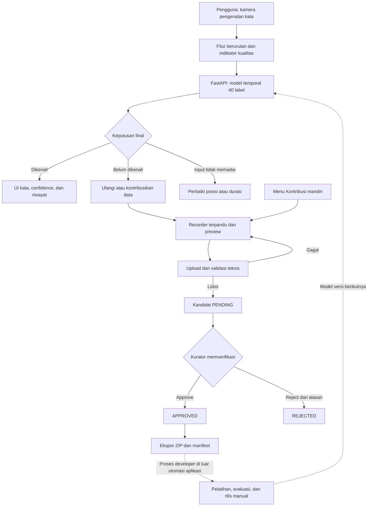

# Pengembangan Modul Pengenalan Kata Isyarat Dinamis dan Siklus Ekspansi Dataset Terpandu pada Signify AI

- **Usulan Judul TA Ketua (Meiske):** Pengembangan Modul Pengenalan Real-Time 40 Kosakata BISINDO Berbasis Model Temporal dengan Umpan Balik Visual dan Penanganan Isyarat Tidak Teridentifikasi pada Signify AI.
- **Usulan Judul TA Bunga (Anggota):** Pengembangan Modul Perekaman Video Terpandu, Validasi, dan Kurasi Dataset untuk Ekspansi Kosakata BISINDO pada Signify AI.

Dokumen proposal teknis untuk dua mahasiswa D3 Teknik Informatika. Dasar analisis adalah snapshot workspace pada **19 September 2026**, instruksi pembagian tugas, implementasi Next.js–FastAPI, migrasi Supabase, artefak model, inventaris dataset, dan perangkat pengujian yang tersedia. Semua fitur, endpoint, tabel, serta angka target berlabel **usulan** merupakan rancangan pengembangan, bukan klaim bahwa fitur sudah tersedia atau target sudah tercapai.

Unit pengenalan adalah **satu isyarat kata/ungkapan terisolasi dalam satu percobaan**, bukan penerjemahan percakapan BISINDO bebas. Sebutan “40 kosakata” mencakup label ungkapan seperti “Apa Kabar” dan “Terima Kasih”. Dataset awal sudah dimiliki tim; pekerjaan Meiske dimulai dari penyiapan dan pemanfaatan data tersebut. Pekerjaan Bunga menghasilkan alur aplikasi untuk menerima dan mengkurasi data tambahan, termasuk label di luar 40 kosakata awal.

---

## 1. Analisis Celah Sistem & Peningkatan Modul (Gap Analysis)

### 1.1. Kondisi Codebase Saat Ini

**Kesimpulan audit:** Signify AI sudah memiliki fondasi aplikasi pengenalan alfabet, autentikasi, riwayat, latihan, dan pengujian. Namun, jalur inferensi yang dipakai frontend saat ini adalah **YOLO11n ONNX di browser**, sedangkan FastAPI merupakan layanan **legacy/dev-only**. Belum ditemukan implementasi pengenalan sekuens kata, perekaman kontribusi video, penyimpanan kandidat, panel kurator, atau ekspor dataset kandidat.

#### Peta struktur dan bukti implementasi

| Area | Bukti pada workspace | Kondisi dan implikasi pengembangan |
|---|---|---|
| Aplikasi frontend | [package.json](apps/frontend/package.json), [workspace routes](apps/frontend/app/%5Blocale%5D/%28workspace%29) | Next.js 16.2.6, React 19.2.3, TypeScript, next-intl, Tailwind, dan Radix. Halaman utama workspace: translate, practice, history, reference, profile. Dua modul baru dapat menggunakan fondasi UI tersebut. |
| Kamera dan state pengenalan | [translate/_content.tsx](apps/frontend/app/%5Blocale%5D/%28workspace%29/translate/_content.tsx), [WebcamCapture.tsx](apps/frontend/components/features/translation/WebcamCapture.tsx) | `getUserMedia`, video tanpa audio, kamera ideal 640×480, start/pause/reset, pembalikan tampilan, serta status izin/perangkat. State menggunakan `useState`, `useRef`, dan callbacks; tidak perlu menambah global state manager untuk MVP. |
| Penjadwalan inferensi | [translate/_content.tsx](apps/frontend/app/%5Blocale%5D/%28workspace%29/translate/_content.tsx) | Interval pengambilan prediksi 200 ms di desktop dan 300 ms di perangkat yang terdeteksi mobile; flag `isBusy` menghindari penumpukan pekerjaan. Interval ini bukan hasil pengukuran FPS atau latensi E2E. |
| Jalur inferensi aktif | [translateApi.ts](apps/frontend/lib/translateApi.ts), [browserYoloRuntime.ts](apps/frontend/lib/browserYoloRuntime.ts), [yoloSession.ts](apps/frontend/lib/yoloSession.ts), [yolo.worker.ts](apps/frontend/lib/yolo.worker.ts) | Frame diteruskan ke ONNX Runtime Web melalui worker, dengan fallback main thread; provider mencoba WebGPU lalu WASM. `translateApi.ts` tidak melakukan HTTP request ke FastAPI. |
| Input/output model | [imagePreprocess.ts](apps/frontend/lib/imagePreprocess.ts), [yoloPreprocess.ts](apps/frontend/lib/yoloPreprocess.ts), [yoloPostprocess.ts](apps/frontend/lib/yoloPostprocess.ts), [manifest model](apps/frontend/public/models/bisindo-yolo11n/manifest.json) | Input satu citra 640×640, tensor `[1,3,640,640]`, output kelas A–Z, confidence, dan bounding box. Belum ada dimensi waktu. |
| Stabilisasi hasil | [translateState.ts](apps/frontend/lib/translateState.ts) | Weighted voting atas prediksi huruf dan fast commit; normalisasi hanya menerima regex `^[A-Z]$`. Voting beberapa prediksi statis tidak sama dengan model yang mempelajari urutan gerakan. |
| Tampilan hasil | [PredictionDisplay.tsx](apps/frontend/components/features/translation/PredictionDisplay.tsx), [PredictionBadge.tsx](apps/frontend/components/features/translation/PredictionBadge.tsx), [SentenceBuilder.tsx](apps/frontend/components/features/translation/SentenceBuilder.tsx) | UI berorientasi satu huruf; token digabung memakai `join("")`. Kata/ungkapan memerlukan ruang tampilan, pemisah antartoken, dan label aksesibilitas baru. |
| Latihan | [practice/_content.tsx](apps/frontend/app/%5Blocale%5D/%28workspace%29/practice/_content.tsx) | Target dan progres masih A–Z. Ada client WebSocket opsional melalui `NEXT_PUBLIC_PRACTICE_WS_URL` untuk micro-feedback; tidak ditemukan endpoint WebSocket pasangannya di FastAPI. Ini belum merupakan pipeline temporal E2E. |
| Persistensi frontend | [userData.ts](apps/frontend/lib/userData.ts), [database.types.ts](apps/frontend/utils/supabase/database.types.ts) | Supabase menyimpan riwayat dan latihan melalui query/RPC. `AlphabetLetter`, `p_letter_code`, dan statistik per huruf mengikat kontrak pada alfabet. |
| Bootstrap backend | [main.py](apps/backend/main.py), [settings.py](apps/backend/app/config/settings.py), [backend README](apps/backend/README.md) | FastAPI memuat singleton YOLO saat startup. Layanan temporal perlu lifecycle dan readiness sendiri agar kontribusi dataset dapat berfungsi tanpa menunggu model temporal siap. |
| Endpoint inferensi lama | [translation.py](apps/backend/app/api/v1/endpoints/translation.py), [ml_service.py](apps/backend/app/services/ml_service.py) | Multipart gambar tunggal, decode OpenCV, inferensi YOLO `.pt`; tidak ada penanganan video/landmark berurutan atau service kurasi. |
| Autentikasi dan otorisasi | [deps.py](apps/backend/app/api/deps.py), [proxy.ts](apps/frontend/proxy.ts), [AuthGuard.tsx](apps/frontend/components/auth/AuthGuard.tsx) | Backend memiliki JWT dependency dengan autentikasi opsional secara default dan verifikasi HS256. Guard frontend melindungi rute workspace lama; rute baru serta hak kurator perlu ditambahkan dan diuji. |
| Database | [migrasi awal](supabase/migrations/20260422090000_init_signify_erd.sql), [sinkronisasi produksi](supabase/migrations/20260605030000_production_data_sync.sql), [pembatasan RPC](supabase/migrations/20260608090000_harden_rpc_function_exposure.sql) | Tabel `profiles`, `model_versions`, `letters`, `translation_sessions`, `translation_entries`, `practice_attempts`, `user_preferences`, beserta RLS/RPC. Belum ada tabel kandidat, metadata video, atau ekspor. |
| Batas data alfabet | [migrasi awal](supabase/migrations/20260422090000_init_signify_erd.sql), [RPC append](supabase/migrations/20260605030000_production_data_sync.sql) | `translation_entries.letter_code` berupa `char(1)` dengan FK ke `letters`; RPC juga menolak input yang bukan satu huruf. Mengirim kata melalui RPC lama tidak menyelesaikan integrasi. |
| Peran akun | [migrasi awal](supabase/migrations/20260422090000_init_signify_erd.sql), [sinkronisasi produksi](supabase/migrations/20260605030000_production_data_sync.sql) | Role sudah `user`/`admin`. Migrasi lanjutan membatasi update profil pengguna ke `display_name` dan `avatar_url`; pola ini perlu dipertahankan agar pengguna tidak dapat mengangkat dirinya menjadi kurator. |
| Deployment | [docker-compose.yml](docker-compose.yml), [Dockerfile](apps/backend/Dockerfile), [panduan deployment](docs/deployment.md) | Compose saat ini mendefinisikan backend lokal. Produksi frontend tidak memerlukan FastAPI. Menambahkan inferensi kata di server merupakan batas layanan baru yang harus didokumentasikan, dikonfigurasi, dan diuji. |
| Pengujian | [tes frontend](apps/frontend/tests), [tes backend](apps/backend/tests), [tes database](supabase/tests/database/production_data_sync.test.sql), [profil Locust](tests/performance/locustfile.py) | Vitest, Playwright, pytest, pgTAP, dan Locust sudah menjadi fondasi. Tes backend memakai mock model; UAT frontend memiliki jalur simulasi. Keberadaan tes tersebut tidak membuktikan akurasi kata dinamis. |
| Dokumen akademik | [draft Meiske](docs/LaporanProyekAkhir_3312401001_MeiskePriskillaSahertian.md), [draft Bunga](docs/LaporanProyekAkhir_3312401034_BungaCitraLestariSitumorang.md), [README](README.md) | Draft terdahulu masih mengarah pada alfabet dan YOLO11n/YOLO26n. Proposal ini mengikuti arahan terbaru: dua proses bisnis pengenalan kata dan ekspansi data. Draft lama bukan bukti implementasi fitur baru. |

Pemeriksaan mencakup inventaris lintas direktori dan penelusuran kode pada jalur kamera, inferensi, persistensi, autentikasi, API, migrasi, serta tes terkait. Aset gambar, video, WASM, checkpoint, dan dokumen biner diinventarisasi sesuai relevansinya; audit ini tidak menyatakan seluruh video telah diputar atau semua artefak biner telah dievaluasi. Database produksi dan deployment aktif tidak diakses dalam penyusunan proposal.

#### Kontrak API yang benar-benar tersedia

| Metode dan endpoint | Input | Output/perilaku saat ini |
|---|---|---|
| `POST /api/v1/translate/predict` | Multipart `file`: JPEG, PNG, WebP; maksimum 2 MiB | `detections[{class, confidence, box}]`, `inference_ms`, `model`. Format tidak didukung: 400; terlalu besar: 413; decode gagal: 422; service tidak tersedia: 503; timeout: 504. Auth mengikuti konfigurasi. |
| `GET /api/v1/translate/classes` | Tidak ada body | `classes` dan `total` dari model YOLO yang dimuat. |
| `GET /health` | Tidak ada body | Status, lokasi model, jumlah kelas, waktu muat model. |

Data pengguna pada aplikasi aktif melewati **Supabase/PostgREST/RPC**, bukan CRUD FastAPI yang sudah lengkap. Dengan demikian, kontribusi backend Bunga mencakup pembangunan layanan data video yang memang belum tersedia.

#### Dataset awal: tersedia, tetapi protokol evaluasinya perlu disiapkan

Inventaris filesystem menemukan **40 direktori label × 50 berkas `.mp4` = 2.000 video**, tanpa berkas berukuran nol, di [data/bisindo_kata/raw_video](data/bisindo_kata/raw_video). Labelnya:

| Kelompok inventaris | Label persis dari direktori |
|---|---|
| 1–10 | Apa; Apa Kabar; Bagaimana; Baik; Belajar; Berapa; Berdiri; Bingung; Dia; Dimana |
| 11–20 | Duduk; Halo; Kalian; Kami; Kamu; Kapan; Kemana; Kita; Makan; Mandi |
| 21–30 | Marah; Melihat; Membaca; Menulis; Mereka; Minum; Pendek; Ramah; Sabar; Saya |
| 31–40 | Sedih; Selamat Malam; Selamat Pagi; Selamat Siang; Selamat Sore; Senang; Siapa; Terima Kasih; Tidur; Tinggi |

Folder tersebut belum menyertakan berkas manifest metadata atau pembagian train/validation/test. Nama berkas tidak membuktikan jumlah pemeraga, sesi rekam, asal variasi, maupun independensi sampel. Durasi, resolusi, FPS, keterbacaan seluruh video, ketepatan label bahasa, dan duplikasi isi belum dinyatakan terverifikasi; `ffprobe` tidak tersedia pada lingkungan audit. Inventaris ini mendukung fakta ketersediaan baseline, bukan klaim bahwa model temporal sudah dilatih atau data sudah bebas kebocoran.

Dataset [data/bisindo/data.yml](data/bisindo/data.yml) tetap mendefinisikan **26 kelas citra alfabet**, terpisah dari dataset kata. Artefak aktif di [models/exports/bisindo_yolo](models/exports/bisindo_yolo) dan manifest frontend masih terkait YOLO alfabet. Nilai mAP model alfabet pada README tidak boleh dipakai sebagai akurasi pengenalan 40 kata.

### 1.2. Peningkatan yang Diusulkan

Bangun dua modul di atas aplikasi yang sama, dengan satu kontrak serah-terima:

1. **Modul Meiske:** kamera langsung → ekstraksi fitur gerak → buffer sekuens → inferensi temporal di FastAPI → hasil kata dan confidence → hasil final atau tawaran kontribusi.
2. **Modul Bunga:** tawaran kontribusi atau menu mandiri → perekaman video terpandu → preview dan submit → validasi teknis → koleksi kandidat → verifikasi kurator → ekspor dataset berlabel.



“Closed-loop” di sini berarti kegagalan/ketiadaan kosakata dapat ditindaklanjuti menjadi data berlabel yang terlacak sampai ekspor. Tahap pelatihan dan rilis berikutnya **tetap manual**. Approval sebuah kandidat tidak otomatis menambahkan kemampuan kata baru pada model yang sedang aktif.

### 1.3. Justifikasi Engineering (Standar D3)

Bobot TA berasal dari penyelesaian kebutuhan pengguna sampai hasil yang dapat diuji: antarmuka, state, kontrak API, aturan bisnis, penyimpanan, penanganan kegagalan, integrasi, serta bukti uji. Model temporal menggunakan metode yang tersedia; tidak ada tuntutan menemukan algoritma baru.

Keseimbangan kontribusi dinilai dari **satu alur E2E milik setiap mahasiswa**, bukan pembagian “Meiske mengerjakan AI/backend, Bunga membuat tampilan”. Meiske harus mendemonstrasikan pengenalan dinamis yang terlihat dan dapat dipakai. Bunga harus mendemonstrasikan siklus kontribusi yang tetap berjalan walau layanan model temporal sedang tidak tersedia. Kedua modul berbagi autentikasi dan kontrak data, tetapi memiliki keluaran dan pengujian mandiri.

---

## 2. Rincian 2 Proses Bisnis & Pembagian Kontribusi E2E

### A. Sub-Modul & Alur Bisnis Ketua (Meiske)

**Fokus Alur:** Pipeline Pengenalan 40 Kata Dinamis Real-Time & Visual Feedback.

**Klaim Kontribusi Sidang:** “Saya mengembangkan alur pengenalan 40 kosakata BISINDO dari kamera web hingga hasil kata dan riwayat melalui layanan inferensi temporal. Kontribusi saya meliputi pengelolaan sekuens, umpan balik kualitas dan confidence, penanganan kegagalan, serta integrasi pemicu kontribusi data yang diuji dari frontend sampai backend.”

#### A.1. Alur pengguna dan batas real-time

1. Pengguna membuka halaman **Pengenalan Kata**, melihat daftar 40 kosakata yang didukung, lalu mengaktifkan kamera.
2. UI memberi panduan posisi tubuh bagian atas dan tangan. Pengguna memulai satu percobaan, memperagakan satu kata, lalu menekan **Selesai**; sistem membatasi durasi maksimal secara otomatis.
3. Selama percobaan, fitur dari frame kamera masuk ke buffer berurutan. UI terus memperbarui status kualitas, durasi, dan progres pengambilan gerakan. Request prediksi sementara dapat dilakukan berkala; hasilnya diberi label **sementara**.
4. Setelah gerakan selesai, backend mengevaluasi sekuens lengkap. Hanya hasil final yang memenuhi keputusan penerimaan ditampilkan sebagai kata dikenali dan masuk riwayat. Satu percobaan menghasilkan paling banyak satu hasil final.
5. Jika gerakan belum dikenali, UI menampilkan **Ulangi gerakan** dan **Kontribusikan contoh**. Pengguna juga dapat memilih **Kata saya belum tersedia** atau **Hasil tidak sesuai**, termasuk saat model mengeluarkan confidence tinggi.
6. Memilih kontribusi menghentikan loop inferensi dan membuka recorder Bunga dengan konteks percobaan. Memilih ulangi mereset buffer agar gerakan sebelumnya tidak tercampur.

Real-time berarti kamera dan feedback aktif selama gerakan serta hasil tersedia dengan jeda terukur setelah sekuens lengkap. MVP memakai batas percobaan eksplisit; segmentasi otomatis percakapan terus-menerus bukan syarat. Rancangan awal durasi percobaan 3–5 detik harus diperiksa terhadap video baseline; durasi gerakan alami tidak boleh dipotong hanya agar cocok dengan angka rancangan. Prediksi sementara tidak dianggap akurasi kata dan tidak boleh menjadi satu-satunya pemicu fallback sebelum gerakan selesai.

#### A.2. Pekerjaan Frontend (FE)

| Luaran Meiske | Rancangan implementasi dan perilaku yang terlihat |
|---|---|
| Halaman `/translate/words` | Route baru di `app/[locale]/(workspace)/translate/words/`; menggunakan shell dan autentikasi yang ada. Kamera, daftar kosakata, mulai/selesai/ulangi, dan ringkasan percobaan tampil dalam satu alur. |
| `DynamicWordCamera` | Menggunakan pola lifecycle kamera yang ada, dengan bingkai panduan tubuh/tangan. Preview mirror hanya untuk tampilan; ekstraksi mempertahankan orientasi kanonis yang konsisten dengan data latih. |
| `TemporalProgress` dan `WordPrediction` | Menampilkan “menunggu”, “mengambil gerakan”, “memproses”, “dikenali”, “belum dikenali”, atau “perbaiki input”; kata/ungkapan tidak dipotong menjadi satu karakter. Status tidak mengandalkan warna saja. |
| `FallbackDialog` | Pilihan ulangi, kontribusi, atau laporkan hasil tidak sesuai; tidak otomatis merekam/mengirim video ketika confidence turun. |
| Hook dan API client baru | Usulan `useDynamicRecognition`, `temporalState.ts`, `wordRecognitionApi.ts`; `useReducer` untuk status dan `useRef` untuk buffer/camera/request. HTTP menggunakan token sesi dan pembatalan request. |
| Daftar hasil kata | Menampilkan token kata/ungkapan dengan spasi antartoken, hapus satu token, dan riwayat hasil final. Tidak menggunakan RPC huruf lama. |

State utama: `IDLE → REQUESTING_CAMERA → READY → CAPTURING → FINALIZING → RECOGNIZED / UNRECOGNIZED / INVALID_INPUT`. Kegagalan koneksi/model menggunakan state `SERVICE_ERROR`; penolakan izin menggunakan `CAMERA_ERROR`. Respons lama diabaikan berdasarkan `attempt_id` dan `request_seq`. Pause, pergantian kamera, tab tersembunyi, logout, dan perpindahan halaman membatalkan percobaan serta membersihkan buffer. Koneksi yang pulih memulai percobaan baru, bukan menyambung dua potongan gerakan yang berjauhan.

**Confidence bukan akurasi.** UI memakai label “Keyakinan model”, misalnya 82%, bukan “Akurasi 82%”. Akurasi dan macro-F1 diperoleh dari pengujian berlabel pada Bagian 4.

#### A.3. Pekerjaan Backend (BE) dan model temporal

**Pilihan implementasi awal:** fitur landmark dua tangan dan tubuh bagian atas → normalisasi serta resampling temporal → **LSTM ringan + lapisan klasifikasi 40 label**. PyTorch sudah tersedia pada backend. LSTM dipilih sebagai metode rekayasa awal, bukan klaim metode terbaik; konfigurasi final diputuskan dari validasi dan latensi pada perangkat target. Implementasi LSTM untuk input berurutan tersedia dalam [dokumentasi PyTorch](https://docs.pytorch.org/docs/2.14/generated/torch.nn.modules.rnn.LSTM.html); rujukan konsep ini tidak mengharuskan upgrade versi dependensi proyek.

Ekstraksi landmark diusulkan memakai MediaPipe pada browser dalam worker. Hand Landmarker menyediakan landmark tangan dan handedness; dokumentasinya menjelaskan mode video serta potensi pemblokiran UI jika inferensi dijalankan pada main thread. Pose Landmarker menyediakan titik tubuh yang dapat dipilih untuk posisi bahu, siku, pergelangan, dan kepala. Keduanya merupakan dependensi/artefak baru, bukan fitur yang sudah ada di repository. [Panduan Hand Landmarker](https://developers.google.com/edge/mediapipe/solutions/vision/hand_landmarker/web_js), [panduan Pose Landmarker](https://developers.google.com/edge/mediapipe/solutions/vision/pose_landmarker).

Rancangan pipeline yang harus dikerjakan Meiske:

1. **Manifest baseline.** Susun identitas video, label, hash, durasi, FPS, pemeraga dan sesi jika diketahui; audit decode, duplikasi, serta kecocokan label. Bekukan daftar 40 label dan urutan class index dalam manifest model.
2. **Kontrak fitur.** Usulan `feature_schema=hands_pose_xy_v1`: 21 titik per tangan dan 7 titik pose (hidung, kedua bahu, siku, pergelangan), masing-masing `x`, `y`, serta mask validitas; total 49 titik atau 147 nilai per frame setelah transformasi. Gunakan slot kiri/kanan anatomis, bukan urutan deteksi yang dapat berubah. Koordinat dihitung terhadap tubuh dengan koreksi rasio aspek, pusat bahu, dan skala bahu yang stabil selama percobaan; jangan menormalisasi setiap tangan secara terpisah hingga lintasan geraknya hilang.
3. **Fitur hilang dan kualitas.** Mask membedakan landmark hilang dari koordinat nol. Jangan menolak semua isyarat satu tangan; kriteria cukup menggunakan bagian tubuh yang dibutuhkan dan proporsi frame valid. Ketiadaan anchor tubuh atau hilangnya hampir seluruh observasi menghasilkan `INVALID_INPUT`, bukan kata baru. Batas kualitas ditetapkan melalui pilot dan disimpan bersama konfigurasi.
4. **Waktu dan preprocessing.** Target awal sampling 15 FPS, maksimum 5 detik, resampling berdasarkan timestamp ke 64 langkah. Nilai ini merupakan konfigurasi awal; audit durasi baseline dan pilot menentukan kelayakannya. Frame tidak boleh diurutkan ulang, digabung antarvideo, atau diacak sebagai pengganti sekuens. Training dan inferensi menggunakan urutan fitur, mask, orientasi, serta normalisasi yang sama.
5. **Pelatihan manual.** Ekstraksi fitur baseline secara offline memakai versi landmarker yang diselaraskan dengan frontend. Simpan manifest split, konfigurasi, seed, preprocessing version, label map, checkpoint, dan hasil evaluasi. Uji kesesuaian fitur browser dan pipeline offline pada klip yang sama untuk mencegah perbedaan distribusi input yang tidak terdeteksi.
6. **Layanan inferensi.** Usulan `TemporalRecognitionService` memuat satu artefak teridentifikasi, melakukan validasi tensor/sekuens, normalisasi, inferensi, dan keputusan hasil. Model berjalan pada mode evaluasi tanpa gradien. Resource, ukuran request, konkurensi, dan timeout dibatasi. Endpoint metadata melaporkan versi serta readiness.
7. **Kontrak hasil.** Keluarkan `RECOGNIZED`, `UNRECOGNIZED`, atau `INVALID_INPUT` untuk request yang sah; error infrastruktur tetap menggunakan HTTP error. Simpan hasil final ke tabel baru, bukan `translation_entries.letter_code`.

Fitur berbasis posisi 2D merupakan batas awal. Pilot wajib menilai pasangan label yang membutuhkan kedalaman atau ekspresi wajah. Jika representasi tidak memadai untuk sebagian baseline, revisi skema fitur sebelum kontrak dibekukan dan laporkan hasil per label; jangan menghapus label sulit diam-diam atau menjanjikan pemahaman BISINDO umum.

#### A.4. Aturan penerimaan dan fallback

| Kondisi | Keputusan sistem | Respons UI |
|---|---|---|
| Kualitas input memadai, sekuens selesai, skor tertinggi `p1 ≥ τ`, selisih `p1−p2 ≥ δ` | `RECOGNIZED`, satu kata final | Kata, confidence, versi model, dan hasil tersimpan. |
| Kualitas memadai tetapi syarat skor/margin tidak terpenuhi | `UNRECOGNIZED`, `word=null` | “Gerakan belum dikenali”; ulangi atau kontribusikan contoh. Kandidat top-1 tidak diperlakukan sebagai label benar. |
| Tangan/anchor tidak cukup, durasi tidak sesuai, atau observasi terlalu terputus | `INVALID_INPUT` dengan alasan | Panduan memperbaiki posisi, pencahayaan, atau durasi. |
| Kamera gagal, jaringan putus, request timeout, model belum siap | Error teknis terpisah | Retry/status layanan. Tidak diberi pesan bahwa kata tidak ada dalam dataset. |
| Pengguna menyatakan kata belum tersedia atau prediksi keliru | Fallback manual | Buka kontribusi dengan alasan pengguna, tanpa mengubah hasil model secara diam-diam. |

`τ` dan `δ` dipilih pada validation set, kemudian dibekukan sebelum test akhir. Nilai ilustratif seperti `τ=0,80` dan `δ=0,15` hanya titik awal eksperimen, bukan parameter tervalidasi. Softmax rendah tidak membuktikan kata di luar baseline, dan softmax tinggi tidak menjamin kata benar. Karena itu, tombol fallback manual tetap diperlukan. MVP tidak mengklaim deteksi open-set yang sempurna.

#### A.5. API temporal yang diusulkan

Transport MVP adalah **REST JSON berisi sekuens landmark**, bukan upload frame JPEG berulang ke endpoint lama. FE menyimpan buffer; backend memproses request stateless. Prediksi sementara maksimal satu request tiap 500 ms dan satu request aktif per percobaan. Prediksi final diprioritaskan; respons sementara yang terlambat diabaikan. WebSocket baru tidak wajib untuk memenuhi alur ini.

| Endpoint baru | Input utama | Keluaran/tanggung jawab |
|---|---|---|
| `GET /api/v1/words/config` | Token pengguna | Daftar 40 kata model aktif, `model_version`, skema fitur, batas durasi/frame, threshold, dan readiness. |
| `POST /api/v1/words/predict` | `attempt_id`, `request_seq`, `is_final`, `model_version`, `feature_schema`, `frame_width`, `frame_height`, `timestamps_ms`, `landmarks`, `valid_mask` | Validasi, inferensi, keputusan, dan timing. Landmark mentah berkoordinat citra dikirim; normalisasi ke fitur model dilakukan dengan kontrak yang sama seperti training. |
| `GET /api/v1/words/events` | Pagination milik pengguna | Riwayat percobaan final, kata/keputusan, confidence, waktu, dan versi model. |

`landmarks` berukuran `[N,49,2]`, mask `[N,49]`, timestamp sepanjang N dan naik ketat. Backend menolak angka non-finite, dimensi salah, N berlebih, serta versi skema/model tidak sesuai. Usulan batas body 512 KiB dan maksimal 150 frame per request; angka final dibekukan setelah pilot. Respons versi tidak cocok menggunakan 409 agar FE mengambil konfigurasi ulang; struktur tidak valid 422; body terlalu besar 413; model tidak siap 503.

Contoh respons **ilustratif**, bukan hasil pengukuran:

```json
{
  "attempt_id": "36f1fbd7-50a6-428d-a9bd-106410100001",
  "request_seq": 8,
  "is_final": true,
  "event_id": "36f1fbd7-50a6-428d-a9bd-106410100002",
  "status": "UNRECOGNIZED",
  "word": null,
  "confidence": 0.48,
  "reason": "LOW_CONFIDENCE",
  "can_contribute": true,
  "model_version": "bisindo-words-v1",
  "feature_schema": "hands_pose_xy_v1",
  "inference_ms": 35,
  "processing_ms": 51
}
```

Untuk hasil sementara, `event_id=null` dan `can_contribute=false`; UI menunggu final kecuali pengguna memilih kontribusi secara manual. Backend menetapkan `user_id` dari token. Unique key `(user_id, attempt_id)` menjamin request final yang diulang tidak menciptakan dua event. Model version dikunci selama satu percobaan.

**Kriteria selesai Meiske:** ke-40 label terdaftar dan dievaluasi; kamera → sekuens → API → hasil final → riwayat berfungsi; kasus tidak dikenali, input buruk, dan gangguan layanan dibedakan; fallback membuka recorder dengan konteks yang benar; laporan model dan latensi dapat dijalankan ulang. Mengganti checkpoint tanpa luaran UI tersebut belum memenuhi kontribusi.

### B. Sub-Modul & Alur Bisnis Bunga (Anggota)

**Fokus Alur:** Pipeline Perekaman Terpandu, Validasi, & Kurasi Dataset Ekspansi.

**Klaim Kontribusi Sidang:** “Saya mengembangkan alur kontribusi dataset dari perekaman video terpandu, validasi otomatis, dan pengelolaan koleksi pengguna sampai verifikasi kurator serta ekspor batch siap diproses untuk pelatihan. Kontribusi saya memastikan video dan label tambahan dapat ditelusuri, dibatasi aksesnya, dan diuji integritasnya tanpa bergantung pada keberhasilan model pengenalan.”

#### B.1. Alur pengguna, kurator, dan state kandidat

1. Pengguna membuka menu **Kontribusi** secara langsung atau melalui fallback Meiske. Form membedakan **contoh tambahan kata yang sudah ada** dan **usulan kata baru**. Kegagalan model tidak otomatis dianggap label baru.
2. Pengguna mengisi/memilih label, membaca panduan tubuh bagian atas dan kedua tangan agar tidak terpotong, serta menyetujui penggunaan rekaman untuk pengembangan dataset.
3. Recorder menghitung mundur tiga detik, merekam target empat detik dalam batas **3–5 detik**, lalu menampilkan playback. Pengguna dapat merekam ulang atau membatalkan sebelum submit. Audio tidak diperlukan.
4. Video final dikirim ke backend hanya setelah pengguna memilih **Kirim**. Backend memeriksa konten file; video yang lolos menjadi kandidat `PENDING`.
5. Halaman **Kontribusi Saya** menampilkan status, label usulan, metadata singkat, preview, serta catatan kurator. Pengguna dapat menghapus satu atau beberapa kontribusi miliknya.
6. Kurator membuka antrean, memutar video, memeriksa kecocokan label dan kelengkapan gerakan, lalu menetapkan `APPROVED` atau `REJECTED`. Alasan penolakan wajib; koreksi label disimpan sebagai label final beserta catatan.
7. Kurator memilih kandidat approved dan membuat ekspor ZIP. Aplikasi menampilkan ringkasan jumlah video/label, identitas ekspor, dan unduhan arsip berisi video serta manifest.

State bisnis utama: `PENDING → APPROVED` atau `PENDING → REJECTED`. Upload yang gagal validasi tidak dibuat sebagai kandidat `REJECTED`, karena belum menjalani keputusan kurator. Untuk MVP, kandidat yang sudah diputuskan tidak diedit isinya; pengguna mengirim ulang sebagai kandidat baru yang dapat merujuk `resubmission_of`. Penghapusan memakai `deleted_at` sebagai atribut terpisah dari tiga status tersebut.

#### B.2. Pekerjaan Frontend (FE)

| Luaran Bunga | Rancangan UI yang wajib terlihat |
|---|---|
| `/contributions/new` | `GuidedRecorder`: panduan posisi, input label, consent, countdown, timer, stop otomatis, indikator merekam, playback, rekam ulang, submit, progress/error. |
| `/contributions` | `ContributionList`: riwayat milik pengguna, filter status, pagination, pilih beberapa item, hapus tunggal/massal, dan catatan penolakan. |
| `/curation` | `ReviewQueue`: antrean kandidat dan detail video, label usulan/final, metadata teknis, konteks sumber, Approve/Reject, kolom alasan. |
| Ekspor dalam `/curation` | Pilih kandidat approved, ringkasan batch, tombol ekspor, status proses, dan unduh ZIP. |
| Lifecycle recorder | State `IDLE → COUNTDOWN → RECORDING → PREVIEW → UPLOADING → SUBMITTED`; error/batal kembali ke state yang jelas. Object URL dicabut setelah preview selesai, track kamera dihentikan saat keluar. |

Gunakan `MediaRecorder.isTypeSupported()` untuk memilih container/codec yang benar-benar didukung browser, lalu kirim MIME hasil recorder; jangan menganggap semua browser menghasilkan MP4. Pengumpulan chunk mengikuti event `dataavailable`, dan submit menunggu rekaman selesai. Ini sesuai kapabilitas yang didokumentasikan pada [MediaRecorder](https://developer.mozilla.org/en-US/docs/Web/API/MediaRecorder). Jika browser tidak mendukung kombinasi yang dilayani backend, UI memberikan penjelasan sebelum perekaman.

Target awal dukungan: WebM VP8/VP9 dan MP4 H.264 yang lolos uji decoder/playback pada browser sasaran. Perubahan tab, pencabutan izin, atau kamera terlepas membatalkan rekaman yang tidak utuh. Durasi UI hanya panduan; keputusan teknis tetap memakai durasi hasil decode di backend.

#### B.3. Pekerjaan Backend (BE): ingest dan validasi

Bangun router `contributions.py`, `curation.py`, dan `dataset_exports.py`; service `video_validation_service.py`, `contribution_service.py`, serta `dataset_export_service.py`. File dan metadata disimpan melalui backend agar pengguna tidak dapat menetapkan status approval sendiri.

Usulan kebijakan validasi awal:

| Pemeriksaan | Aturan MVP | Respons jika gagal |
|---|---|---|
| Ukuran | Maksimum 20 MiB, dihitung selama streaming upload; tidak mempercayai `Content-Length` saja | 413, pesan batas ukuran; file sementara dibersihkan. |
| Ekstensi, MIME, isi | `.webm`/`.mp4`, MIME video yang sesuai, container/codec aktual diperiksa decoder | 415 untuk tipe/codec tidak didukung; nama file bukan dasar tunggal. |
| Integritas | Ada stream video yang dapat didecode; file kosong, rusak, atau data lain yang menyamar ditolak | 422 dengan kode alasan yang aman. |
| Durasi | 3,00–5,00 detik; recorder menargetkan 4 detik untuk menghindari batas | 422 `INVALID_DURATION`, durasi terukur dikembalikan. Toleransi encoder, jika diperlukan dari pilot, harus menjadi konfigurasi tertulis dan ikut diuji. |
| Resolusi | Target rekam 640×480; batas awal sisi pendek ≥480 dan sisi panjang ≤1920, setelah memperhitungkan rotasi | 422 `INVALID_RESOLUTION`. |
| FPS dan timestamp | Target 15–30 FPS; baca frame timestamp untuk sumber variable frame rate dan durasi yang tidak tersedia di header | 422 jika sekuens tidak dapat divalidasi; kebijakan metadata terdokumentasi. |
| Metadata bisnis | Label tidak kosong, panjang dibatasi, consent ada, konteks event milik pengguna jika disertakan | 422/403 sesuai jenis kegagalan. |
| Duplikasi | SHA-256 konten dan request idempotency; minimal cegah upload identik pengguna yang sama | 409 atau kembalikan hasil request sebelumnya sesuai kontrak. Hash tidak mendeteksi seluruh kemiripan visual. |

Gunakan `ffprobe` untuk membaca stream/container/metadata dan pemeriksaan decode melalui FFmpeg dengan timeout. Dokumentasi menyediakan output terstruktur melalui format JSON serta pemilihan data stream dan frame. Durasi yang hilang dari header WebM tidak langsung dianggap nol; parser harus menghitung dari timestamp/frame bila diperlukan. [Dokumentasi ffprobe](https://ffmpeg.org/ffprobe.html).

Binary FFmpeg/ffprobe belum disiapkan oleh Dockerfile saat ini dan menjadi dependensi backend baru. Jalankan proses dengan argumen terpisah, nama file internal UUID, batas waktu/resource, dan tanpa memasukkan label ke perintah shell. Validasi otomatis menilai **kelayakan teknis**, bukan kebenaran makna BISINDO; verifikasi semantik tetap tugas kurator yang memahami label dan variasi isyarat.

Penyimpanan usulan menggunakan **bucket privat Supabase Storage** dan metadata PostgreSQL. Backend memberi akses playback sementara hanya kepada pemilik dan kurator. Video tidak diletakkan dalam `apps/frontend/public`. Urutan ingest: validasi di file sementara → simpan objek privat → insert metadata kandidat; jika insert gagal, hapus objek yang baru dibuat. Jika cleanup gagal, catat agar dapat dibersihkan ulang; jangan melaporkan upload sukses sebelum objek dan metadata konsisten.

#### B.4. API kontribusi, kurasi, dan ekspor yang diusulkan

Seluruh endpoint berikut mewajibkan autentikasi. `admin` yang sudah tersedia berfungsi sebagai **kurator** pada MVP; tidak perlu menambah sistem manajemen role baru. Pemeriksaan role dilakukan di server pada setiap operasi kurasi/ekspor.

| Endpoint baru | Kontrak ringkas | Hak akses |
|---|---|---|
| `POST /api/v1/contributions` | Multipart `video`, `proposed_label`, `contribution_kind`, `consent_version`, `consent_granted`, opsional `source_event_id`, `source_reason`, `collection_session_id`, `resubmission_of`; header `Idempotency-Key`. Menghasilkan 201 dengan `id`, `PENDING`, metadata. | Pengguna terautentikasi; pemilik ditentukan token. |
| `GET /api/v1/contributions` | Filter status dan cursor, hanya data milik pengguna | Pemilik. |
| `GET /api/v1/contributions/{id}` | Detail metadata, catatan, dan URL playback berumur pendek | Pemilik atau kurator. |
| `DELETE /api/v1/contributions/{id}` | Soft-delete metadata dan pembersihan objek; request ulang aman | Pemilik. |
| `POST /api/v1/contributions/bulk-delete` | `{ids:[...]}`, batas 50 ID, seluruh kepemilikan diverifikasi sebelum perubahan | Pemilik; ID di luar hak akses menggagalkan batch tanpa penghapusan parsial tersembunyi. |
| `GET /api/v1/curation/candidates` | Antrean berfilter status/label dan pagination | Kurator. |
| `PATCH /api/v1/curation/candidates/{id}/review` | `{decision, canonical_label, note, expected_version}`; transisi hanya dari `PENDING` | Kurator; Reject mewajibkan alasan. Konflik versi: 409. |
| `POST /api/v1/dataset-exports` | `{candidate_ids:[...]}`; snapshot kandidat approved, aktif, dan berizin; batas awal 50 video/200 MiB | Kurator. |
| `GET /api/v1/dataset-exports/{id}` | Status `BUILDING/READY/FAILED`, ringkasan, checksum dan tautan unduh saat ready | Kurator. |

Untuk MVP, pembuatan ZIP dapat diselesaikan dalam request terbatas lalu mengembalikan 201 dengan status `READY`. Batas batch menjaga waktu proses tetap terkendali; jika benchmark melewati timeout, pecah batch terlebih dahulu. Tidak diperlukan Redis/Celery sebagai prasyarat. Status proses disimpan agar kegagalan dapat ditampilkan dan pembersihan file sementara dapat ditelusuri.

#### B.5. Penghapusan dan keputusan kurasi

- Kontributor tidak dapat mengganti `status`, `reviewed_by`, atau label final melalui API maupun akses database langsung. Akun biasa tidak dapat membuka isi kandidat orang lain dengan menebak ID atau URL storage.
- Approve/Reject menggunakan update bersyarat atas `PENDING` dan `expected_version`, serta menyimpan aktor, waktu, dan catatan keputusan dalam transaksi. Dua reviewer tidak boleh saling menimpa keputusan tanpa diketahui.
- Koreksi label disimpan pada `canonical_label`; `proposed_label` tetap dipertahankan untuk keterlacakan. Normalisasi whitespace/huruf besar-kecil mencegah label kembar, tetapi penyamaan makna/varian ditentukan kurator.
- Hapus tunggal/massal berlaku bagi kontribusi milik pengguna, termasuk yang sudah approved. `deleted_at` langsung mengecualikan video dari antrean dan ekspor berikutnya; penghapusan objek yang gagal ditandai untuk retry.
- Snapshot ekspor harus ditandai tidak lagi berlaku dan file ZIP terkelola dibersihkan jika salah satu sumbernya ditarik. Saat build, cek kembali sumber sebelum publikasi; kegagalan konsistensi menggagalkan batch. Salinan yang sudah diunduh developer tidak dapat dihapus dari jarak jauh; manifest kandidat memberi dasar untuk mengecualikannya dari pelatihan berikutnya.

#### B.6. Service Export Dataset

Ekspor memuat **hanya** kandidat `APPROVED`, belum dihapus, consent aktif, video tersedia, dan label final terisi. Kurator memilih batch eksplisit; ekspor tidak otomatis mengambil seluruh storage. Simpan daftar ID serta hash sumber saat snapshot, verifikasi kembali sebelum menyediakan ZIP, dan laporkan jumlah yang dikemas.

Contoh struktur arsip yang diusulkan:

```text
signify-expansion-<export_id>/
├── videos/
│   ├── <label_id>_<slug-kata>/
│   │   ├── <candidate_uuid>.webm
│   │   └── <candidate_uuid>.mp4
│   └── <label_id>_<slug-kata-lain>/
│       └── <candidate_uuid>.webm
├── manifest.csv
├── labels.json
└── README.md
```

`manifest.csv` minimal memuat `candidate_id`, `relative_path`, `label_id`, `canonical_label`, `sha256`, `duration_ms`, `width`, `height`, `fps`, `codec`, `signer_pseudonym`, `collection_session_id`, `source_kind`, `consent_version`, dan waktu approval. `signer_pseudonym` konsisten untuk satu pemeraga, bukan email/nama akun; bila satu akun merekam orang berbeda, pilih ID pemeraga samaran yang berbeda. Metadata yang tidak diketahui ditulis tidak diketahui, bukan dibuat-buat.

`labels.json` memetakan ID label stabil ke nama kata/ungkapan. ID label dataset dibedakan dari class index model yang terikat versi. README menjelaskan versi skema, preprocessing yang diperlukan, asal batch, dan bahwa pemisahan train/validation/test belum otomatis dilakukan. Gunakan ID dan slug yang dibentuk server agar label berisi `../`, separator path, atau karakter spreadsheet berbahaya tidak menjadi path arsip atau formula aktif.

“Siap latih” berarti video berlabel, terverifikasi, terstruktur, dan dapat dibaca loader dengan identitas sumber yang jelas; tidak berarti ZIP berisi bobot model baru. Format MP4/WebM asli dapat dipertahankan selama loader Meiske mendukung keduanya. Ekstraksi fitur, penggabungan baseline, pembagian data, pelatihan, evaluasi, dan rilis versi berikutnya tetap dijalankan manual oleh developer. Uji serah-terima menggunakan loader untuk membaca seluruh manifest dan setidaknya mengekstrak fitur satu batch nyata.

**Kriteria selesai Bunga:** recorder → preview → upload → validasi → riwayat → hapus tunggal/massal → kurasi → ZIP berfungsi E2E; penolakan dan retry dapat dipahami pengguna; hak akses serta integritas metadata/file/arsip lulus uji; minimal satu label di luar baseline dapat melewati seluruh alur tanpa mengubah model aktif.

### C. Titik Integrasi, Skema Data, dan Batas Kepemilikan

#### C.1. Kontrak serah-terima Meiske → Bunga

**Titik integrasi utama berada pada hasil final halaman `/translate/words`, bukan di dalam model.** Meiske menghasilkan event dan menyediakan tombol fallback; Bunga menerima konteks tersebut pada `/contributions/new?source_event_id=<uuid>`. Backend mengambil detail event serta memeriksa pemiliknya. Label prediksi tidak langsung diisikan sebagai label kebenaran; pengguna tetap menentukan label usulan dan kurator memverifikasinya.

Konteks minimal terdiri atas `source_event_id`, alasan (`LOW_CONFIDENCE`, `AMBIGUOUS`, `USER_UNKNOWN_WORD`, atau `USER_DISAGREES`), versi model, serta waktu percobaan. Alasan pengguna disimpan terpisah dari keputusan model. Metadata tersebut cukup untuk menelusuri sumber kandidat; sekuens landmark dan video kamera sebelumnya tidak otomatis disimpan sebagai kontribusi.

Meiske menghentikan worker/loop dan melepas track sebelum route kontribusi membuka kamera baru. Bunga merekam ulang secara terpandu setelah persetujuan pengguna sehingga durasi, framing, dan preview konsisten. Jika pengguna masuk dari menu mandiri, `source_event_id=null` tetap sah. Gangguan layanan temporal tidak memblokir recorder maupun kurasi.

#### C.2. Skema database yang diusulkan

Gunakan migrasi baru pada [supabase/migrations](supabase/migrations), kemudian sinkronkan [database.types.ts](apps/frontend/utils/supabase/database.types.ts). Tabel alfabet tidak dipaksa menampung kata melalui cast `char(1)`. Rancangan minimal berikut menambahkan tabel sesuai kebutuhan data; tidak memerlukan database atau microservice terpisah.

| Tabel/artefak | Kolom dan constraint utama | Penanggung jawab |
|---|---|---|
| `vocabulary_labels` baru | `id`, `display_label`, `normalized_key` unik, `is_baseline`, `created_at`. Seed tepat 40 label awal; label baru disahkan saat review. `is_baseline` tidak menyatakan dukungan model aktif. | Kontrak bersama; migrasi dan pengelolaan label oleh Bunga, seed/map awal diverifikasi Meiske. |
| `model_versions` diperluas | Model temporal memakai `model_name` tersendiri, misalnya `bisindo_words`, agar tidak mengganti model alfabet. Tambahkan `task_type` dan metadata konfigurasi temporal; `input_size` lama tidak dipakai sebagai panjang sekuens. | Meiske. |
| Manifest model terversi | `model_version`, checksum artefak, `feature_schema`, preprocessing version, jumlah langkah, class index → `label_id`, threshold, split ID, hasil evaluasi. Loader memeriksa kecocokan manifest dan bobot. | Meiske. |
| `word_recognition_events` baru | `id`, `user_id`, `attempt_id`, `model_version_id`, `status`, `predicted_label_id` nullable, confidence, reason, timing, `created_at`. Unique `(user_id,attempt_id)`; label hanya terisi pada hasil dikenali. Tidak menyimpan video mentah. | Meiske. |
| `dataset_candidates` baru | `id`, `user_id`, `proposed_label`, `canonical_label_id` nullable, `contribution_kind`, `source_event_id` nullable, `source_reason`, `resubmission_of` nullable, `storage_key`, hash, metadata video, pemeraga/sesi samaran, consent, status, reviewer/waktu/catatan, `version`, `deleted_at`, status cleanup, timestamps. | Bunga. |
| `dataset_exports` baru | `id`, `created_by`, `status`, `manifest_version`, jumlah file/label/byte, lokasi ZIP privat, checksum, waktu dan alasan gagal/invalidasi. | Bunga. |
| `dataset_export_items` baru | `export_id`, `candidate_id`, `label_id`, hash dan path snapshot; PK gabungan. Menelusuri isi batch dan dampak penghapusan kandidat. | Bunga. |

Constraint minimum: confidence 0–1; enum keputusan dan status; `APPROVED` mewajibkan label final, reviewer, waktu review; `REJECTED` mewajibkan catatan; FK valid; nilai durasi/ukuran positif. Kandidat hanya dibuat sesudah pemeriksaan teknis lolos. Jika event inferensi suatu saat dihapus, hubungan sumber dapat menjadi null tanpa menghapus kandidat yang telah dikirim atas persetujuan tersendiri.

RLS memisahkan data pemilik; akses kurator dan operasi lintas pemilik diperiksa di backend. Kredensial service role, jika digunakan untuk storage atau transaksi kurasi, hanya berada di server; karena kredensial tersebut dapat melewati RLS, setiap query mutasi tetap harus membatasi aktor, pemilik, dan status secara eksplisit. Pengguna biasa tidak mendapat jalur tulis langsung yang dapat memalsukan review.

Jangan mengasumsikan JWT dependency lama cukup untuk konfigurasi produksi baru. Pilih verifikasi sesuai konfigurasi penandatanganan Supabase proyek yang sebenarnya, wajibkan token valid untuk endpoint baru, dan uji kasus kedaluwarsa/salah issuer/audience/signature. Kegagalan konfigurasi autentikasi menutup akses, bukan memproses kontribusi sebagai anonim. Pemberian role `admin` dilakukan oleh pengelola tepercaya; tidak ada menu promosi diri.

#### C.3. Peta perubahan dan kepemilikan E2E

Seluruh lokasi bertanda baru di bawah merupakan rencana, bukan berkas yang sudah dibuat oleh proposal ini.

| Paket pekerjaan | Meiske | Bunga | Hasil serah-terima |
|---|---|---|---|
| FE pengenalan kata | Route, kamera temporal, state, feedback, API client, fallback, riwayat kata | Mengonsumsi konteks fallback | Event dan navigasi menuju recorder. |
| BE pengenalan kata | `words.py`, schema request/response, `temporal_recognition_service.py`, manifest, pipeline preprocessing/training manual | Menyepakati `source_event_id` dan alasan | Kontrak contoh sukses/tidak dikenali/error yang dapat dipakai pengembangan recorder. |
| FE kontribusi | Menguji pemicu dari halaman kata | Recorder, koleksi, hapus, review, ekspor | Alur dapat diakses mandiri maupun dari fallback. |
| BE kontribusi | Memastikan loader dapat membaca ekspor | Validasi, kandidat, storage, review, ZIP | Batch ekspansi berlabel yang lolos loader. |
| Database | Event dan versi model temporal | Label/kandidat/ekspor dan kebijakan akses | FK, constraint, serta migrasi berurutan disepakati bersama. |
| Fondasi bersama | Spesifikasi fitur, konfigurasi inferensi, readiness, pengujian akurasi/latensi | Konfigurasi upload/storage, otorisasi kurator, integritas file/ZIP | Dokumentasi kontrak dan skenario integrasi. |
| Bukti TA | Laporan model, evaluasi 40 label, uji E2E pengenalan, demo fallback | Uji validasi/CRUD/role/ZIP, UAT kontributor-kurator, demo ekspansi | Laporan individu menyebut reuse dan kepemilikan kode dengan jelas. |

Tambahkan rute kontribusi/kurasi pada [proxy.ts](apps/frontend/proxy.ts), [konfigurasi navigasi](apps/frontend/components/layout/mobile-nav/workspaceNavConfig.ts), sidebar, guard, dan pesan i18n ID/EN. Route `/translate/words` sudah berada di bawah prefix translate, tetapi tetap memerlukan pengujian akses dan navigasi. Menyembunyikan menu kurasi bukan pengganti otorisasi server.

Frontend dapat tetap di-host sebagai aplikasi Next.js; FastAPI baru perlu layanan yang dapat menjalankan model temporal dan decoder video, koneksi database/storage, HTTPS, CORS terbatasi, serta konfigurasi URL API. Untuk demo, FE dan BE dapat berjalan lokal pada perangkat yang telah diuji; deployment cloud berskala besar bukan syarat. Pisahkan readiness model dari kesehatan modul kontribusi: kegagalan memuat checkpoint tidak boleh mematikan CRUD/recorder Bunga.

### D. Tahapan Pelaksanaan yang Diusulkan

Jadwal awal delapan minggu berikut merupakan estimasi kerja, bukan tenggat yang sudah disepakati. Dua mahasiswa dapat bekerja bersamaan setelah kontrak dibekukan.

| Tahap | Meiske | Bunga | Bukti selesai |
|---|---|---|---|
| Minggu 1: audit dan kontrak | Manifest 40 kata, pemeriksaan video/split, pilot fitur dan perangkat | Uji kemampuan recorder/codec, kebutuhan kurator, skema kandidat | Kontrak API, skema fitur, aturan validasi, dan rancangan UI disepakati. |
| Minggu 2–3: irisan E2E pertama | Kamera → fitur → endpoint → hasil sementara/final; mulai training baseline | Rekam → preview → upload → metadata/storage → koleksi | Masing-masing alur dapat dijalankan melalui UI dan backend. |
| Minggu 4–5: aturan bisnis | Threshold, quality gate, riwayat, fallback dan lifecycle | Hapus tunggal/massal, panel review, label final, ZIP | Integrasi event → recorder → approval → ekspor berjalan. |
| Minggu 6: kualitas dan integritas | Evaluasi seluruh 40 label, latensi, perbaikan fitur berdasarkan validation | Uji batas file/durasi, konflik review, RLS, cleanup, konsistensi ZIP | Konfigurasi dibekukan sebelum test akhir. |
| Minggu 7: uji akhir | Test model terpisah dan pengenalan dengan kamera nyata | UAT kontribusi/kurator dan loader ekspor nyata | Hasil aktual, kegagalan, serta batas klaim dilaporkan. |
| Minggu 8: bukti sidang | Demo, laporan individu, panduan menjalankan model | Demo, laporan individu, panduan kurasi/ekspor | Instalasi dapat diulang dan kedua kontribusi dapat dibuktikan mandiri. |

---

## 3. Pengendalian Ruang Lingkup (Anti-Scope Creep via 4 Filter)

### 3.1. Fitur Dalam Scope (In-Scope)

- Pengenalan satu isyarat kata/ungkapan per percobaan untuk **40 label baseline**, dengan model temporal dan kamera langsung.
- UI progres temporal, hasil kata, confidence, penanganan input buruk/error, riwayat final, serta fallback otomatis berbasis keputusan dan fallback manual pengguna.
- Perekaman kontribusi terpandu 3–5 detik, playback, label usulan, persetujuan, submit, dan validasi teknis backend.
- Koleksi kontribusi milik pengguna, status/catatan, penghapusan tunggal dan massal.
- Panel kurator, verifikasi label/gerakan, Approve/Reject, alasan penolakan, dan kontrol akses.
- Ekspor batch approved ke ZIP berstruktur label beserta manifest dan pemeriksaan oleh loader pelatihan.
- Perubahan API, database, storage, navigasi, serta pengujian yang diperlukan agar seluruh alur tersebut bekerja E2E.
- Penyiapan, pelatihan, dan evaluasi **model baseline pertama secara manual** oleh Meiske; kemampuan ekspor dan serah-terima data baru oleh Bunga.

### 3.2. Fitur Luar Scope (Out-of-Scope)

- Avatar 3D, animasi kompleks, aplikasi penerjemah 3D, dan generasi gerakan dari teks.
- Text-to-Speech berat atau layanan suara baru. Komponen TTS browser lama bukan fokus peningkatan maupun klaim kontribusi baru.
- Auto-retraining, auto-deployment model, aktivasi kosakata otomatis setelah approval, dan platform MLOps lengkap.
- Penerjemahan kalimat bebas/percakapan kontinu, segmentasi seluruh bahasa isyarat, banyak orang sekaligus, dan klaim seluruh dialek/variasi BISINDO.
- Perbandingan banyak arsitektur, kompetisi novelty, dan kewajiban migrasi YOLO11n ke YOLO26n pada proyek kata dinamis ini.
- Ekspansi jumlah kelas model produksi melampaui 40 sebagai syarat kelulusan; **pengumpulan/kurasi/ekspor data di luar 40 tetap wajib** bagi modul Bunga.
- Training di browser, deployment inferensi temporal offline sebagai jalur kedua, aplikasi mobile native, pembayaran, gamifikasi, serta pengelolaan organisasi yang tidak menunjang dua alur inti.

### 3.3. Evaluasi 4 Filter

| Filter | Meiske: pengenalan kata | Bunga: ekspansi dataset | Bukti yang perlu dibawa ke sidang |
|---|---|---|---|
| **Ada Kebutuhan** | Pengguna perlu mengenali gerakan kata, sedangkan sistem aktif masih memproses citra huruf. | Pengguna membutuhkan jalur untuk contoh gagal/label belum tersedia; pengelola membutuhkan kandidat yang dapat diverifikasi. | Gap dari kode, skenario penggunaan, dan konfirmasi kebutuhan melalui calon pengguna/kurator. |
| **Ada Alasan** | Bentuk tangan tunggal tidak mewakili seluruh urutan perubahan posisi dan gerakan. | Koleksi file informal menyulitkan pemeriksaan label, status, asal data, dan pemilihan data latih. | Diagram alur sebelum/sesudah dan contoh kegagalan yang dapat ditindaklanjuti. |
| **Ada Kemampuan** | Dataset 2.000 video sudah tersedia; kamera, autentikasi, React, FastAPI, PyTorch, dan alat tes sudah menjadi fondasi. Pilot menentukan batas fitur dan perangkat. | Recorder, validasi file, CRUD, keputusan review, dan ZIP adalah pekerjaan fullstack yang terukur; role admin dan Supabase dapat digunakan kembali. | Irisan E2E awal, kontrak yang kecil, jadwal, dan uji pada perangkat target. Ketersediaan data tidak menjamin akurasi sebelum diuji. |
| **Ada Nilai** | Pengguna memperoleh kata dan feedback langsung serta langkah lanjut saat pengenalan gagal. | Pengelola memperoleh data tambahan berlabel, terlacak, dan siap diteruskan ke pelatihan manual. | Dua demo mandiri, demo integrasi, laporan kualitas, dan satu batch ekspansi nyata. |

Sebuah fitur tambahan hanya diterima jika lolos keempat filter dan mempunyai pemilik, UI/alur yang jelas, kontrak backend, serta kriteria uji. Jika tidak, pindahkan ke pengembangan lanjutan. Beban skripsi tidak ditambah dengan fitur dekoratif untuk menutupi alur inti yang belum selesai.

### 3.4. Risiko Nyata dan Keputusan Pembatasan

| Risiko | Dampak | Respons dalam scope |
|---|---|---|
| Metadata pemeraga/sesi baseline belum tersedia | Split acak berpotensi memberi estimasi terlalu optimistis | Lengkapi manifest, audit asal rekaman, dan batasi klaim bila data pemeraga independen tidak tersedia. |
| Durasi/framing baseline berbeda dari kamera | Model baik pada file tetapi gagal pada penggunaan langsung | Pilot lintas data, preprocessing sama, dan uji kamera nyata sejak irisan E2E pertama. |
| Kata baru memperoleh confidence tinggi sebagai kata lama | Trigger threshold saja gagal menangkap seluruh kasus | Fallback manual “kata belum tersedia/hasil tidak sesuai” dan uji negatif terpisah. |
| Fitur landmark kurang membedakan sebagian label | Kualitas pengenalan tidak merata | Evaluasi per label dan tinjau representasi pada fase awal; pertahankan laporan semua 40 label. |
| Codec browser/durasi WebM berbeda | Rekaman sah ditolak atau tidak bisa diputar | Negosiasi MIME, validasi dari decode, fixture MP4/WebM nyata, dan matriks browser. |
| Model/decoder membuat API lambat | UI menunggu dan upload berebut resource | Satu request inferensi aktif per percobaan, batas konkurensi decoder/batch, timeout, dan uji beban kecil sesuai target demo. |
| Kurator belum memahami kosakata/variasi isyarat | Approval tidak menjamin ketepatan semantik | Libatkan pemeriksa yang kompeten dan sediakan pedoman label; verifikasi oleh tim teknis saja dilaporkan sebagai keterbatasan. |

---

## 4. Strategi Pengujian Sistem (Akurat & Berbobot)

### 4.1. Prinsip Pembuktian

Pisahkan tiga pertanyaan: **apakah aplikasi berjalan benar**, **seberapa baik model mengenali kata**, dan **apakah dataset ekspansi memenuhi aturan integritas**. Tes dengan respons model tiruan membuktikan kontrak dan state UI; tes tersebut tidak menghasilkan akurasi model. Demikian pula, file lolos validasi teknis belum tentu benar secara semantik.

Gunakan fondasi tes yang ada: Vitest untuk state/komponen, pytest untuk service dan kontrak HTTP FastAPI, pgTAP untuk constraint/RLS, Playwright untuk alur browser, serta skrip evaluasi model dan benchmark terpisah. Untuk endpoint baru, tambahkan tes melalui HTTP/ASGI client agar routing, multipart, auth dependency, serialisasi, dan status code ikut diuji; pemanggilan fungsi Python langsung saja belum cukup.

Seluruh angka penerimaan di bawah adalah **target awal proposal**, untuk dibekukan setelah pilot bersama pembimbing sebelum pengujian akhir. Tidak ada klaim angka sudah tercapai dalam dokumen ini.

### 4.2. Pengujian Alur Ketua (Meiske)

#### A. Protokol data dan evaluasi model

1. Audit video dan catat jumlah data valid per label, asal pemeraga/sesi, serta duplikasi. Split dilakukan **per pemeraga** jika metadata dan jumlah pemeraga memungkinkan; jika tidak, minimal per sesi rekam/kelompok sumber dengan batas klaim yang dinyatakan.
2. Target awal rasio train/validation/test adalah 70/15/15, menyesuaikan kelompok dan memastikan semua label terwakili. Persentase aktual dilaporkan; jangan memecah frame dari satu video atau turunan augmentasi ke split berbeda. Duplikasi lintas split diperiksa sebelum training.
3. Jika hanya satu pemeraga atau asal rekaman tidak diketahui, jangan menyebut hasil signer-independent. Rekaman uji dari pemeraga baru diperlukan untuk klaim generalisasi ke orang baru; jika belum tersedia, nyatakan keterbatasannya.
4. Training memakai train; pemilihan parameter model, quality gate, `τ`, dan `δ` memakai validation. Test akhir disimpan terpisah dan tidak dipakai untuk memilih threshold.
5. Laporkan **top-1 accuracy**, **macro precision/recall/F1**, confusion matrix **40×40**, jumlah sampel serta recall tiap label. Untuk keputusan yang dapat menolak, tambahkan kolom penolakan, acceptance coverage, dan akurasi di antara prediksi yang diterima. Penolakan pada sampel baseline tetap dihitung gagal pada keberhasilan pengenalan final, bukan dihapus dari penyebut.
6. Sediakan kumpulan uji negatif terpisah: isyarat di luar baseline yang diverifikasi, gerakan non-isyarat, serta kondisi kualitas buruk. Pisahkan negatif untuk tuning dari negatif test akhir. Laporkan false acceptance kata di luar baseline, tingkat penolakan, dan false rejection kata baseline. Jangan mengartikan “ditolak” sebagai klasifikasi kata baru yang benar.
7. Usulan target model awal: top-1 accuracy ≥80% dan macro-F1 ≥0,75 pada test akhir yang dinyatakan; sasaran keberhasilan final accepted-and-correct ≥75% atas seluruh percobaan baseline valid, serta false acceptance ≤10% pada set isyarat di luar baseline. Laporkan jumlah sampel dan ketidakpastian; angka ini sasaran rekayasa awal, bukan standar universal atau syarat formal kampus.

Baseline YOLO alfabet tidak dibandingkan langsung dengan LSTM kata menggunakan angka mAP vs accuracy, karena tugas, input, dan label berbeda. Bukti peningkatan produk adalah tersedianya alur kata dinamis dan proses tindak lanjut data, dengan kualitas model dinilai sesuai tugasnya.

#### B. Uji fungsional FE–BE dan kegagalan

| ID | Kasus uji | Hasil yang diharapkan |
|---|---|---|
| M-01 | Enumerasi config dan inferensi untuk semua 40 label menggunakan test berlabel | Map kelas konsisten; tidak ada label hilang/tertukar. Prediksi salah tetap masuk laporan kualitas. |
| M-02 | Sekuens terlalu sedikit, timestamp mundur, NaN/Infinity, dimensi salah, body/frame berlebih | Backend menolak sesuai kontrak; UI memberi pesan dan dapat mengulang. |
| M-03 | Batas threshold `τ−ε`, `τ`, `τ+ε` serta margin `δ` | Keputusan server dan tampilan UI konsisten; angka confidence ditampilkan sebagai keyakinan. |
| M-04 | Tangan tidak terlihat vs kata di luar baseline vs API timeout | `INVALID_INPUT`, `UNRECOGNIZED`, dan error layanan dibedakan. Error layanan tidak otomatis menjadi kandidat data. |
| M-05 | Request lambat, respons tidak berurutan, retry final yang sama | Hasil percobaan lama tidak menimpa percobaan baru; satu attempt tidak menggandakan event. |
| M-06 | Izin kamera ditolak, pause, tab tersembunyi, flip, logout, pindah halaman | Stream/worker/request dibersihkan; buffer lama tidak terbawa; tidak ada commit setelah percobaan dibatalkan. |
| M-07 | Label ungkapan “Terima Kasih”, dua token hasil berturut-turut | Satu label tetap satu token; teks memiliki pemisah yang benar; tidak masuk RPC `char(1)`. |
| M-08 | Fallback otomatis, hasil keliru ber-confidence tinggi, dan “kata belum tersedia” | Konteks yang sesuai membuka recorder; pengguna tetap memilih label usulan dan consent. |
| M-09 | Token kedaluwarsa, versi model berubah, service belum siap | Respons auth/409/503 ditangani; tidak ada hasil palsu atau data lintas akun. |
| M-10 | Uji kamera langsung oleh pengguna dengan model asli | Video demo dan log menunjukkan sekuens nyata, hasil final, confidence, dan alasan keputusan; tidak menggunakan test hook sebagai bukti model. |

#### C. Pengujian latensi dan respons antarmuka

Definisikan pengukuran agar “real-time” tidak hanya berasal dari angka waktu model:

- `L_model`: forward pass model pada backend.
- `L_processing`: validasi, preprocessing, dan inferensi pada backend.
- `L_after_capture`: waktu sejak sekuens final ditutup di browser sampai hasil final dirender; mencakup antrean, jaringan, backend, dan render. Pengukuran ini menggunakan jam monotonic browser yang sama.
- `L_total`: dari mulai percobaan sampai hasil final tampil; mencakup durasi gerakan 3–5 detik. Laporkan terpisah dari `L_after_capture`.

Target awal `L_after_capture` P95 ≤1.000 ms pada konfigurasi demo yang dibekukan; ukur minimal 100 percobaan setelah warmup dan laporkan cold start secara terpisah. Catat CPU/GPU/RAM backend, perangkat/browser frontend, versi model, ukuran sekuens, jaringan, dan beban 1 serta 2 pengguna bersamaan. Laporkan P50/P95, error rate, FPS ekstraksi aktual, dan apakah tombol tetap responsif. Durasi model `inference_ms` tidak cukup untuk memenuhi target tersebut.

### 4.3. Pengujian Alur Bunga

#### A. Batas recorder dan validasi teknis

| ID | Kasus uji | Hasil yang diharapkan |
|---|---|---|
| B-01 | Countdown, rekam 4 detik, stop otomatis, playback, rekam ulang | Preview sesuai rekaman terakhir; upload hanya setelah klik Kirim. |
| B-02 | Durasi 2,99; 3,00; 4,00; 5,00; 5,01 detik | Aturan batas sesuai konfigurasi backend; fixture diukur dari decode, bukan nama file. |
| B-03 | Ukuran tepat di bawah, sama, dan di atas 20 MiB | Dua pertama dapat melewati pemeriksaan ukuran; yang berlebih 413 dan tidak meninggalkan kandidat/file aktif. |
| B-04 | Ekstensi palsu, MIME palsu, file kosong/rusak, codec tak didukung | Server membaca konten dan menolak dengan alasan yang sesuai; tidak mengandalkan validasi FE. |
| B-05 | Resolusi sisi pendek 479/480 piksel, sisi panjang 1920/1921, metadata rotasi | Penerimaan sesuai batas dan orientasi aktual. |
| B-06 | MP4 dan WebM nyata; durasi header hilang; variable frame rate | Metadata dihitung dengan benar atau ditolak dengan pesan jelas; preview kurator dapat diputar. |
| B-07 | Permission revoke, tab berpindah, kamera terlepas, jaringan putus saat upload | Rekaman parsial tidak dianggap sukses; pengguna dapat mengulang, cleanup berjalan. |
| B-08 | Label kosong/panjang berlebih, consent tidak ada, event milik akun lain | Ditolak backend; tidak ada kandidat sah yang terbentuk. |

Tes browser memakai fake clock/media bila diperlukan untuk state deterministik, tetapi paling sedikit satu pengujian manual pada Chromium desktop dan satu perangkat mobile nyata harus memakai kamera serta file hasil recorder asli. Dukungan Firefox/WebKit diuji bila dinyatakan sebagai browser target; codec yang tidak didukung harus menghasilkan bantuan yang jelas.

#### B. Integritas CRUD, otorisasi, dan kurasi

| ID | Kasus uji | Hasil yang diharapkan |
|---|---|---|
| B-09 | Upload valid, refresh halaman, filter, pagination | Metadata dan objek tersedia; kandidat `PENDING` muncul pada akun yang benar. |
| B-10 | Klik submit ganda/retry request setelah koneksi terputus | `Idempotency-Key` tidak menciptakan kandidat/objek ganda; isi berbeda pada key yang sama ditolak. |
| B-11 | Hapus tunggal, massal, request hapus berulang | Kandidat hilang dari koleksi aktif dan ekspor baru; operasi ulang aman dan cleanup objek dapat dilacak. |
| B-12 | Batch hapus berisi ID pengguna lain | Tidak ada perubahan parsial tanpa pemberitahuan; kepemilikan diverifikasi di server. |
| B-13 | Akun biasa memanggil review/export, mengubah role/status, atau membuka video orang lain | Ditolak API/RLS/storage; URL privat tidak dapat diperoleh di luar hak akses. |
| B-14 | Approve, Reject tanpa alasan, koreksi label, dua reviewer bersamaan | Transisi valid tersimpan beserta aktor/waktu; alasan wajib; stale version menghasilkan 409. |
| B-15 | Upload storage berhasil tetapi insert database gagal; objek gagal dihapus | Operasi tidak dilaporkan sukses palsu; kompensasi/retry cleanup dibuktikan. |
| B-16 | Label baru di luar baseline approved | Label final dapat diekspor, sedangkan config model aktif tetap 40 label sampai rilis manual berikutnya. |

#### C. Verifikasi ekspor ZIP

| ID | Kasus uji | Hasil yang diharapkan |
|---|---|---|
| B-17 | Campuran `PENDING`, `APPROVED`, `REJECTED`, serta kandidat terhapus | Hanya himpunan approved aktif yang sah dapat diekspor; pemilihan ID tidak sah ditolak dengan alasan. |
| B-18 | Ekstrak ZIP, cocokkan manifest/label/path/byte/hash | Jumlah dan identitas video tepat; tidak ada file hilang, ekstra, atau salah label; checksum cocok. |
| B-19 | Label `../`, slash, karakter non-ASCII, duplikasi nama, prefix formula spreadsheet | Path tetap aman memakai UUID/slug server; nama tampilan tetap terbaca dan metadata tidak menjadi formula aktif. |
| B-20 | Batch kosong, melebihi 50 video/200 MiB, file storage hilang, build timeout | Tidak ada ZIP “berhasil” yang parsial; pesan batas/gagal dan cleanup file sementara jelas. |
| B-21 | Kandidat dihapus saat build atau setelah ekspor tersedia | Publikasi dibatalkan atau ekspor ditandai invalid; objek ekspor terkelola dibersihkan sesuai kebijakan. |
| B-22 | Loader Meiske membaca satu batch nyata dengan label di luar baseline | Semua baris manifest dapat dibaca dan video didecode; fitur dapat diekstrak tanpa pelatihan otomatis. |

Target integritas: **100% skenario aturan bisnis kritis lulus**, 100% isi ekspor cocok dengan manifest sumber yang dipilih, dan tidak ada akses lintas akun yang berhasil pada matriks pengujian. Kelulusan tes teknis tidak disebut sebagai “akurasi label 100%”; label ditinjau kurator dengan pedoman yang dicatat.

### 4.4. Pengujian Integrasi dan Penerimaan Pengguna

Skenario integrasi wajib: hasil tidak dikenali → pilih kontribusi → recorder membuka konteks event → upload valid → `PENDING` → kurator approve → ekspor → loader membaca batch. Ulangi dengan entri melalui menu kontribusi mandiri dan dengan backend temporal tidak siap untuk membuktikan kemandirian alur Bunga.

Usulan UAT melibatkan 5–8 calon pengguna kontribusi/pengenalan dan 1–2 kurator yang memahami isyarat terkait; jumlah aktual serta pengalaman peserta dilaporkan. Tugas mencakup mengenali kata baseline, memahami pesan confidence/kegagalan, merekam ulang, mengirim, menemukan alasan reject, menghapus kontribusi, dan mengekspor kandidat sah. Catat keberhasilan tugas, waktu, kesalahan, bantuan yang diperlukan, serta komentar pengguna. Target awal ≥80% tugas inti selesai tanpa bantuan; seluruh tugas administrasi kritis kurator harus berhasil pada skenario yang telah ditetapkan.

Uji aksesibilitas mencakup navigasi keyboard, fokus dialog fallback/review, label tombol, status yang dapat dibaca pembaca layar, dan feedback tanpa bergantung pada suara atau warna. Tangkapan layar simulasi dipisahkan dari bukti penggunaan nyata.

Regresi tetap memeriksa autentikasi, pengenalan alfabet, practice, history lama, preferensi, i18n, serta build frontend. Pipeline CI yang ada dapat diperluas melalui [.github/workflows/ci-frontend.yml](.github/workflows/ci-frontend.yml), [ci-backend.yml](.github/workflows/ci-backend.yml), dan [ci-database.yml](.github/workflows/ci-database.yml). Uji model/video yang berat dijalankan terpisah dengan fixture terkontrol; tidak perlu mengirim 2.000 video ke setiap job CI.

### 4.5. Skenario Live Demo Sidang

Rencana demo sekitar 12–15 menit, dengan dua akun terpisah: kontributor dan kurator.

| Urutan | Pelaksana | Aksi interaktif | Hal yang dibuktikan |
|---|---|---|---|
| 1 | Meiske | Tampilkan versi model, daftar 40 label, dan ringkasan test set; buka kamera kata | Baseline teridentifikasi; UI baru berbeda secara fungsional dari pengenalan alfabet. |
| 2 | Meiske | Peragakan 2–3 kata baseline, termasuk sebuah ungkapan; tunjukkan progres dan hasil final | Model memproses gerakan berurutan; output UI, confidence, riwayat, dan latensi dapat diamati. |
| 3 | Meiske | Coba gerakan yang belum dikenali atau kata di luar baseline | Jika model menolak, gunakan fallback otomatis. Jika model salah menerima, tunjukkan keterbatasannya dan pilih “hasil tidak sesuai/kata belum tersedia”; tidak memaksa hasil demo palsu. |
| 4 | Meiske → Bunga | Klik kontribusi dan tunjukkan konteks sumber pada halaman recorder | Integrasi proses bisnis dan penghentian kamera/loop sebelumnya. |
| 5 | Bunga | Isi label, setujui penggunaan, hitung mundur, rekam 4 detik, playback, lalu rekam ulang atau kirim | Guided collection berjalan di aplikasi, dengan keputusan submit oleh pengguna. |
| 6 | Bunga | Tunjukkan contoh file tidak valid pada fixture uji, kemudian kandidat valid `PENDING` di koleksi | Backend benar-benar memvalidasi konten; status teknis dan keputusan kurator berbeda. |
| 7 | Bunga | Hapus satu serta beberapa kandidat uji milik akun sendiri | CRUD koleksi dan konsistensi penghapusan. |
| 8 | Bunga | Login kurator, putar kandidat, reject satu dengan alasan dan approve kandidat lain | Review semantik, role, catatan, dan transisi status. |
| 9 | Bunga | Ekspor batch approved, buka ZIP dan manifest, jalankan loader | Hanya data sah masuk dataset dan berkas siap diserahkan untuk pelatihan manual. |
| 10 | Bersama | Tunjukkan label baru ada pada ekspor tetapi daftar model tetap 40; buka kontribusi dari menu mandiri | Batas kemampuan model jujur, alur Bunga mandiri, dan retraining bukan proses otomatis. |

Siapkan perangkat, koneksi, akun, izin kamera, dan service lokal yang telah diuji. Klip rekaman dapat digunakan sebagai cadangan demonstrasi API jika kamera bermasalah, tetapi harus diumumkan sebagai replay dan bukan bukti performa live. Penguji tetap dapat melihat laporan uji semua 40 label; demo beberapa kata tidak menggantikannya.

### 4.6. Paket Bukti dan Batas Klaim Akhir

**Paket Meiske:** kode FE–BE pengenalan, manifest baseline dan split, artefak/model card, konfigurasi preprocessing/threshold, laporan confusion matrix dan metrik per label, benchmark latensi, tes state/API/auth, serta rekaman demo kamera nyata dan fallback.

**Paket Bunga:** kode FE–BE recorder/koleksi/kurasi, migrasi dan kebijakan akses, fixture validasi, bukti CRUD serta konflik review, catatan UAT, satu batch ZIP nyata berikut manifest/hash, dan hasil pemeriksaan loader.

**Paket bersama:** kontrak API, diagram alur, petunjuk menjalankan sistem, matriks kebutuhan → implementasi → test case → hasil aktual, daftar masalah yang belum selesai, serta pembagian kontribusi individu. Tulis hasil aktual setelah implementasi; jangan mengganti target proposal dengan angka keberhasilan tanpa bukti.

Dokumen ini merupakan hasil analisis dan perancangan. Penyusunannya tidak menjalankan training temporal, tidak mengevaluasi seluruh video, tidak menguji layanan produksi, dan tidak mengubah kode aplikasi. Kelayakan teknis final ditentukan oleh pilot, pengujian E2E, serta hasil model pada protokol yang telah ditetapkan.
